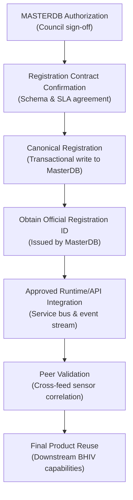

# BHIV vNEXT MASTERDB-GEO-QUEST-01: Aircraft Data Pipeline

## 1. Project Overview
This repository contains the validated data engineering pipeline, live raw capture, cleansed dataset, and candidate registration packet for the **BHIV vNEXT MASTERDB-GEO-QUEST-01** geospatial task.

The project demonstrates an end-to-end data lifecycle: collecting real-world aircraft surveillance data around Mumbai airspace, performing statistical profiling, executing deterministic cleaning and schema normalization, routing invalid records through an isolated quarantine mechanism, running automated data quality gates, verifying open database licensing, and packaging candidate registration payloads for the BHIV MasterDB ecosystem.

---

## 2. Core Governance Architecture & Separation

A strict distinction is maintained between **Source**, **Dataset**, and **Capability**:

| Pillar | Governance Definition | Implementation in this Project |
| :--- | :--- | :--- |
| **SOURCE** | *Where information comes from* | **`adsb.lol` live ADS-B data feed** (utilizing the open-source God's Eye View community SDR aggregation network). Endpoint: `https://api.adsb.lol/v2/lat/19.0760/lon/72.8777/dist/100`. |
| **DATASET** | *The governed data asset* | **`BHIV vNEXT Normalized Aircraft Observation Dataset`** (`cleaned/aircraft_cleaned.json`), an immutable, schema-normalized, provenance-tagged spatial candidate asset. |
| **CAPABILITY** | *What BHIV can do with the data* | **`gev.aircraft_tracking` (Aircraft Tracking & Airspace Situational Awareness)**: Near real-time positioning, kinematic surveillance, and spatial query resolution for BHIV services. |

> [!IMPORTANT]
> **Candidate Status**: The cleaned dataset is a **candidate governed spatial dataset**. It is **NOT** a MasterDB canonical dataset and must not be described as such until formal authorization is granted.

---

## 3. Data Integrity & Verification Summary

*   **Zero Artificial Data**: Under strict data integrity rules, **zero aircraft records were generated, invented, simulated, mocked, fabricated, or hard-coded**.
*   **Real Data Captured**: Exactly **19 real aircraft records** were captured from the live `adsb.lol` API at `2026-10-03T08:26:35.695048+00:00` (HTTP status: `200 OK`, latency: `0.699s`).
*   **Cleaning & Quarantine Results**:
    *   **19 records were cleaned and normalized** into `cleaned/aircraft_cleaned.json`.
    *   **0 records were quarantined** (`cleaned/aircraft_quarantine.json` remains clean and empty).
    *   Conservation equation verified: $\text{Raw (19)} = \text{Cleaned (19)} + \text{Quarantined (0)}$.
*   **Quality Gates**: **6 / 6 automated quality checks passed** with zero defects (`validation/aircraft_quality_report.json`):
    1. `CHK_01_RECORD_CONSERVATION` $\rightarrow$ **PASS** ($19 = 19 + 0$)
    2. `CHK_02_IDENTIFIER_UNIQUENESS` $\rightarrow$ **PASS** (19 unique ICAO hex codes, 0 duplicates)
    3. `CHK_03_COORDINATE_VALIDITY` $\rightarrow$ **PASS** (100% within valid WGS84 bounds: Lat `[17.525521°, 19.832883°]`, Lon `[71.867365°, 74.218489°]`)
    4. `CHK_04_NUMERIC_RANGE_VALIDITY` $\rightarrow$ **PASS** (Altitudes: `1,025`–`35,000 ft`, Speeds: `11.8`–`491.4 kts`, Tracks: `1.8°`–`354.14°`)
    5. `CHK_05_TIMESTAMP_AGE_INTEGRITY` $\rightarrow$ **PASS** (Zero negative sensor latencies)
    6. `CHK_06_PROVENANCE_COMPLETENESS` $\rightarrow$ **PASS** (100% of records embed full audit provenance)
*   **Licence & Provenance Verified**:
    *   Data/Database: **Open Data Commons Open Database License (ODbL) v1.0** (verified against official `adsb.lol` documentation and `github.com/adsblol/globe_history`).
    *   API Code: **BSD 3-Clause License** (verified against `github.com/adsblol/api`).
    *   Contributor Ingestion: **Creative Commons Zero (CC0 1.0)**.
    *   Attribution Requirement: Any redistribution must attribute to `"adsb.lol and its contributors"`.
    *   Lineage: Transponders $\rightarrow$ Volunteer SDR Feeders $\rightarrow$ adsb.lol $\rightarrow$ `raw/aircraft_raw.json` $\rightarrow$ `cleaned/aircraft_cleaned.json`.

---

## 4. MasterDB Governance Boundaries

To preserve architectural truth, the following boundaries are strictly enforced:
*   **MASTERDB Registration is still PENDING**: No write has been executed to the MasterDB spatial layer.
*   **Runtime Integration is still PENDING**: Live event streaming and production service bus routing have not been activated.
*   **MASTERDB Owner / Write Authority Must Be Confirmed**: Canonical registration requires explicit sign-off from the appointed BHIV Geospatial Domain Data Steward.
*   **No Registration ID Has Been Created or Invented**: All registration identifiers remain explicitly marked `PENDING / NOT PERFORMED`.

---

## 5. Integration Handover

For the BHIV MasterDB engineering and integration team, the remaining path from this candidate repository to production reuse follows a strict sequence:



### Sequence of Next Steps:
1.  **MASTERDB Authorization**: Obtain formal governance approval to ingest external aircraft surveillance data.
2.  **Registration Contract Confirmation**: Confirm schema contracts, update cadence SLAs, and storage lifecycle policies using `registration/registration_payloads.md`.
3.  **Canonical Registration**: Execute the canonical write to the MasterDB spatial truth catalog.
4.  **Obtain Official Registration ID**: Issue and record the official MasterDB UUID for Source, Dataset, and Capability.
5.  **Approved Runtime/API Integration**: Wire the collection script into the BHIV telemetry ingestion daemon or scheduled orchestrator.
6.  **Peer Validation**: Conduct real-world sensor correlation against secondary radar or commercial surveillance feeds.
7.  **Final Product Reuse**: Expose `gev.aircraft_tracking` to downstream BHIV consumers (Airspace Monitor, Flight Anomaly Detector, Spatial Query Engine).

---

## 6. Repository Structure

```
MASTERDB-GEO-QUEST-01/
├── README.md                           # Project guide, governance, and handover roadmap
├── HANDOVER_PACKET.md                   # Comprehensive 10-point handover dossier
├── .gitignore                          # Excludes secrets, credentials, env, and bytecode
├── raw/
│   ├── aircraft_raw.json               # Exact unmodified live API response (19 records)
│   └── acquisition_metadata.json       # HTTP status, latency, headers, UTC timestamp
├── cleaned/
│   ├── aircraft_cleaned.json           # 19 normalized, schema-conformant aircraft observations
│   └── aircraft_quarantine.json        # Quarantine store (0 records; schema intact)
├── metadata/
│   └── aircraft_metadata.json          # Dataset metadata, verified ODbL licence, and schema
├── validation/
│   ├── profiling_report.json           # Statistical profile of raw data across 52 fields
│   ├── aircraft_quality_report.json     # 6/6 quality checks, missing-value stats
│   ├── execution_status.md             # Component-level PASS / PENDING status matrix
│   ├── final_audit_report.md           # Formal audit verdict: READY
│   └── next_action.md                  # Single recommended next governance action
├── registration/
│   ├── source_record.json              # Proposed Source registration payload (adsb.lol / GEV)
│   ├── dataset_record.json             # Candidate Dataset registration payload (PENDING)
│   ├── capability_record.json          # Proposed Capability registration payload (PENDING)
│   ├── registration_payloads.md        # Field-by-field verification & authorization matrix
│   └── registration_checklist.md       # 9 PASS gates vs 7 PENDING governance gates
└── scripts/
    ├── collect_aircraft.py             # Live HTTP collector with timeout & error handling
    ├── profile_aircraft.py             # Statistical profiler with PENDING fallback
    ├── clean_aircraft.py               # Deterministic cleanser, normalizer & quarantine router
    ├── validate_aircraft.py            # Quality gate validation and reporter
    └── generate_metadata.py            # Verified metadata generator
```

---

## 7. Execution Guide

To inspect or re-verify the pipeline locally:

```powershell
# 1. Inspect raw collection metadata
python -m json.tool raw/acquisition_metadata.json

# 2. Run statistical profiler
python scripts/profile_aircraft.py

# 3. Execute data cleansing and normalization
python scripts/clean_aircraft.py

# 4. Execute quality validation gates
python scripts/validate_aircraft.py

# 5. Check audit verdict
cat validation/execution_status.md
cat validation/next_action.md
```

---

## 8. Governance Disclaimer
*This repository represents a validated candidate data asset prepared for handover. MasterDB canonical status, registration IDs, runtime streaming, and production integration remain PENDING formal authorization.*
