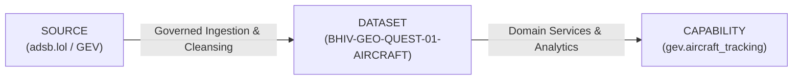

# BHIV vNEXT MASTERDB-GEO-QUEST-01: Registration Payloads Documentation

## Governance Hierarchy: SOURCE → DATASET → CAPABILITY

The proposed registration packet establishes the foundational linkage between raw real-world intelligence and downstream BHIV operational capabilities:

*   **SOURCE**: Where the information originates (`adsb.lol` open ADS-B aggregation network).
*   **DATASET**: The governed data asset created through rigorous cleaning, normalization, and quality validation.
*   **CAPABILITY**: What BHIV can do with the data (airspace entity tracking and situational awareness).

---

## 1. SOURCE Registration Payload (`source_record.json`)

| Field Name | Proposed Value | Evidence / Source | Verified | MasterDB Authorization Required? |
| :--- | :--- | :--- | :--- | :--- |
| `source_registration_status` | `"PENDING AUTHORIZATION"` | Governance requirement | **YES** | **YES** (Authorized write required) |
| `source_name` | `"adsb.lol"` | Live API connection | **YES** | NO (External identity) |
| `source_type` | `"external_geospatial_aircraft_surveillance_feed"` | Pipeline architecture | **YES** | NO |
| `reference_project` | `"God's Eye View (GEV)"` | Project specification | **YES** | NO |
| `endpoint_used` | `"https://api.adsb.lol/v2/lat/19.0760/lon/72.8777/dist/100"` | `raw/acquisition_metadata.json` | **YES** | NO |
| `acquisition_method` | `"Automated HTTP GET REST query"` | `scripts/collect_aircraft.py` | **YES** | NO |
| `exact_acquisition_timestamp_utc`| `"2026-10-03T08:26:35.695048+00:00"` | `raw/acquisition_metadata.json` | **YES** | NO |
| `http_status_received` | `200` | `raw/acquisition_metadata.json` | **YES** | NO |
| `verified_licence.data_licence` | `"Open Data Commons ODbL v1.0"` | Official `adsb.lol` documentation | **YES** | NO |
| `verified_licence.api_software_licence` | `"BSD 3-Clause License"` | Official `github.com/adsblol/api` repo | **YES** | NO |
| `attribution_requirements` | `"Credit 'adsb.lol and its contributors' + ODbL notice"` | ODbL v1.0 Section 4.3 | **YES** | NO |
| `provenance` | Aircraft transponder $\rightarrow$ SDR feeders $\rightarrow$ adsb.lol $\rightarrow$ `raw/aircraft_raw.json` | Pipeline architecture & logs | **YES** | NO |
| `source_limitations` | Feeder density, MLAT dilution, barometric divergence, oceanic VHF horizon | Aviation sensor physics & documentation | **YES** | NO |
| `masterdb_registration_id` | `"PENDING / NOT PERFORMED"` | Boundary rule | **YES** | **YES** (Must be issued by MasterDB) |

---

## 2. DATASET Registration Payload (`dataset_record.json`)

| Field Name | Proposed Value | Evidence / Source | Verified | MasterDB Authorization Required? |
| :--- | :--- | :--- | :--- | :--- |
| `registration_status` | `"PENDING"` | Governance requirement | **YES** | **YES** (Approval required) |
| `dataset_name` | `"BHIV vNEXT Normalized Aircraft Observation Dataset"` | `metadata/aircraft_metadata.json` | **YES** | NO |
| `proposed_dataset_id` | `"BHIV-GEO-QUEST-01-AIRCRAFT"` | Proposal identifier | **YES** | **YES** (Approval required) |
| `canonical_status` | `"NOT CANONICAL (CANDIDATE ONLY)"` | Governance requirement | **YES** | **YES** (Canonical elevation required) |
| `version` | `"1.0.0-candidate"` | Versioning specification | **YES** | NO |
| `raw_record_count` | `19` | `raw/aircraft_raw.json` | **YES** | NO |
| `cleaned_record_count` | `19` | `cleaned/aircraft_cleaned.json` | **YES** | NO |
| `quarantined_record_count` | `0` | `cleaned/aircraft_quarantine.json` | **YES** | NO |
| `duplicate_hex_identifiers` | `0` | `validation/profiling_report.json` | **YES** | NO |
| `geographic_coverage` | Mumbai FIR (`19.0760° N, 72.8777° E`, 100 nmi radius) | Query specification & verified coordinates | **YES** | NO |
| `schema.field_count` | `20` canonical attributes | `cleaned/aircraft_cleaned.json` | **YES** | **YES** (Schema registration) |
| `transformations_applied` | Whitespace stripped, uppercase hex, surface altitude decoupled, coordinates validated | `scripts/clean_aircraft.py` audit | **YES** | NO |
| `quality_checks_summary` | 6 / 6 Quality Gates passed (`CHK_01` to `CHK_06`) | `validation/aircraft_quality_report.json` | **YES** | NO |
| `intended_consumers` | BHIV MasterDB Spatial Truth Engine, Airspace Monitor, Anomaly Detection | Architectural plan | **YES** | **YES** (Access control authorization) |

---

## 3. CAPABILITY Registration Payload (`capability_record.json`)

| Field Name | Proposed Value | Evidence / Source | Verified | MasterDB Authorization Required? |
| :--- | :--- | :--- | :--- | :--- |
| `capability_registration` | `"PENDING"` | Boundary requirement | **YES** | **YES** (Service registration) |
| `capability_id` | `"gev.aircraft_tracking"` | Proposed capability identifier | **YES** | **YES** (Namespace authorization) |
| `discoverable` | `false` | Boundary requirement | **YES** | **YES** (Registry publication) |
| `registered_in_masterdb` | `false` | Boundary requirement | **YES** | **YES** (MasterDB commit) |
| `purpose` | Near real-time spatial positioning & situational awareness around airspace hubs | Capability definition | **YES** | NO |
| `source_dataset_reference` | `BHIV-GEO-QUEST-01-AIRCRAFT` | `registration/dataset_record.json` | **YES** | NO |
| `inputs` | Center lat/lon, radius nm, optional hex/callsign filters | Capability interface definition | **YES** | **YES** (Contract approval) |
| `outputs` | Normalized aircraft state vector array + query metadata | Schema definition | **YES** | **YES** (Contract approval) |
| `geographic_scope` | Mumbai FIR (initial 100 nmi radius) | Verification query footprint | **YES** | NO |
| `freshness_characteristics` | Polling snapshot / scheduled cadence (< 1.5s pipeline latency) | Performance benchmark | **YES** | NO |
| `dependencies` | `adsb.lol` v2 API, Python 3.9+, WGS84 engine, MasterDB service bus | Technical stack | **YES** | **YES** (Infrastructure provisioning) |
