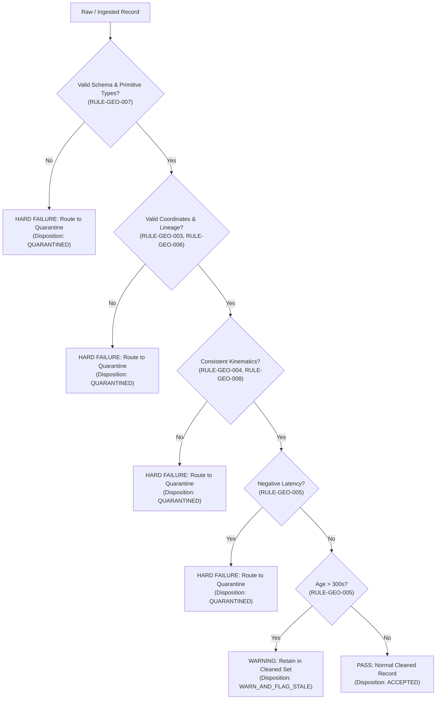

# BHIV vNEXT MASTERDB-GEO-QUEST-01: Deterministic Validation Rule Catalogue

**Dataset ID:** `BHIV-GEO-QUEST-01-AIRCRAFT`
**Capability ID:** `gev.aircraft_tracking`
**Author:** Hariom Upadhyay
**Reviewer:** Harsha Pawar
**Date:** `2026-10-15`
**Version:** `1.0.0`

---

## 1. Governance Principles & Disposition Framework

The MASTERDB ingestion quality framework enforces deterministic, reproducible quality gates before any dataset can be staged or certified for downstream consumption.
To guarantee auditability without silent data mutation:
1. **Zero Silent Dropping / Rewriting:** Problematic records are never silently deleted or mutated. They are routed to an isolated Quarantine Store (`cleaned/aircraft_quarantine.json`) and logged in the Exception Register.
2. **Hard Failures vs Warnings:**
   - **`HARD_FAILURE`**: Severe violations that compromise spatial accuracy, entity identity, mathematical conservation, or legal licensing. Records trigger quarantine or rejection of the batch.
   - **`WARNING`**: Non-fatal anomalies (such as elevated observation latency or non-standard squawk codes) where data remains usable for situational awareness. The record is flagged but retained in the cleaned set.

---

## 2. Rule Catalogue Matrix

| Rule ID | Rule Name | Target Field(s) | Predicate / Condition | Severity | Expected Result | Disposition | Justification |
|---|---|---|---|---|---|---|---|
| **RULE-GEO-001** | Record Conservation Accounting | Entire Batch | `len(raw) == len(cleaned) + len(quarantined)` | **HARD_FAILURE** | Strict mathematical balance | Batch Quarantine / Reject | Ingestion pipelines must account for 100% of input records; unaccounted records represent silent data loss. |
| **RULE-GEO-002** | Entity Identifier Uniqueness | `aircraft_hex_id` | Unique within batch (`count(hex) == 1`) | **HARD_FAILURE** | Zero duplicate aircraft addresses | Quarantine duplicate occurrences | Mode S transponder addresses are globally unique 24-bit identifiers; duplicates indicate feed collision or corrupt multi-path reception. |
| **RULE-GEO-003** | Geographic Coordinate Spatial Envelope | `latitude`, `longitude` | `lat` in `[-90, +90]`, `lon` in `[-180, +180]`, non-null, numeric | **HARD_FAILURE** | Coordinates strictly within EPSG:4326 bounds | Quarantine invalid record | Geospatial queries and distance calculations fail catastrophically on out-of-bounds or non-numeric coordinates. |
| **RULE-GEO-004** | Kinematic Range Aviation Envelopes | `ground_speed_kts`, `altitude_baro_ft`, `true_track_deg` | `gs` in `[0.0, 1500.0]`, `alt` in `[-2000, 85000]`, `track` in `[0.0, 360.0]` | **HARD_FAILURE** | Values within physically realistic flight limits | Quarantine physically impossible records | Values outside physical flight envelopes indicate sensor malfunction, bit flips, or non-aviation radio interference. |
| **RULE-GEO-005** | Temporal Latency & Freshness | `last_seen_seconds`, `position_age_seconds` | `seen >= 0.0` and `seen_pos >= 0.0`. If `seen > 300.0` -> warning | **HARD_FAILURE** for negative; **WARNING** for age > 300s | Non-negative timestamps; warning if stale | Negative: Quarantine; Stale: Flagged with `STALE` status | Negative latencies indicate clock synchronization errors. High latencies (>5 min) represent stale situational data but remain historically valid. |
| **RULE-GEO-006** | Audit Lineage & Provenance Completeness | `provenance` | `provenance` object exists, containing `source_url` and `raw_acquisition_utc` | **HARD_FAILURE** | 100% records possess verifiable lineage | Reject record | Governed datasets require verifiable cryptographic or source audit trails before downstream consumption. |
| **RULE-GEO-007** | Mandatory Schema Conformance & Type Safety | Mandatory fields | `hex`, `lat`, `lon`, `is_on_ground` present and conformant to schema types | **HARD_FAILURE** | Conformance to Data Dictionary primitive types | Quarantine malformed record | Type mismatches trigger runtime deserialization exceptions in consuming analytics engines. |
| **RULE-GEO-008** | Surface State Measurement Decoupling | `is_on_ground`, `altitude_baro_ft`, `ground_speed_kts` | If `is_on_ground == true`, `altitude_baro_ft <= 500` and `ground_speed_kts <= 200` | **HARD_FAILURE** | Surface state consistent with kinematic altitude and speed | Quarantine contradictory record | An aircraft reporting surface telemetry while at 35,000 ft or Mach 2 represents transponder encoding corruption. |
| **RULE-GEO-009** | Dataset Identity vs Schema Disambiguation | Metadata / Dataset Contract | `dataset_id != schema_version` and version strings follow semantic governance | **HARD_FAILURE** | Unambiguous separation between data asset identity and schema contract | Reject ambiguous payload | Prevents schema drift and contract confusion between asset instances and architectural data definitions. |
| **RULE-GEO-010** | Open Database License Compliance | `licence`, `attribution` | ODbL v1.0 declared, attribution statement `"adsb.lol and its contributors"` present | **HARD_FAILURE** | Full legal compliance with upstream ODbL §4.3 and §4.4 | Reject non-compliant asset | Ingestion of external open datasets without preserving attribution and copyleft clauses breaches legal compliance. |

---

## 3. Warning vs. Hard Failure Classification

