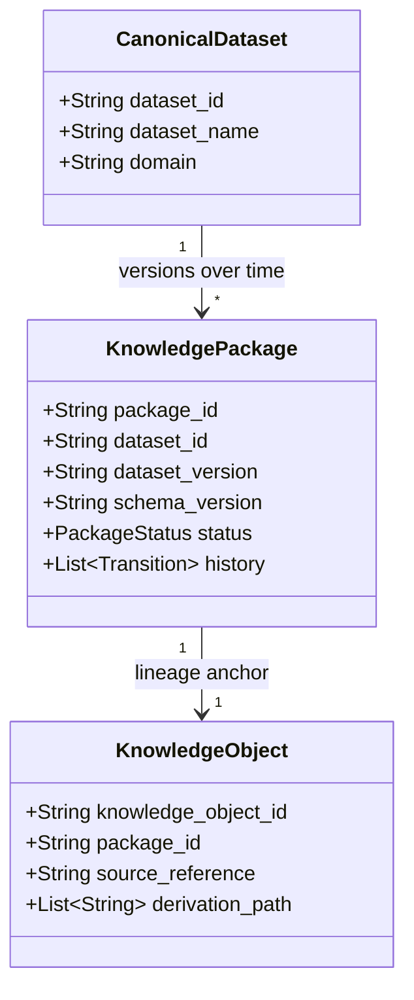

# MASTERDB Plug-and-Play Integration Contract

**Document Title:** MASTERDB Universal Ecosystem Plug-and-Play Integration Contract  
**Version:** 1.0.0  
**Target Platform:** MASTERDB Core Knowledge Platform (`v1.3.0`)  
**Specification Source:** Runtime Implementation & OpenAPI 3.1.0 Specification  
**Applies To:** All consuming and contributing systems (TANTRA, MANTRA, YANTRA, VAJRA, BIQOS, and External Agents)  

---

## Executive Overview

This contract establishes the **minimum operational and technical specification** that every consuming or contributing system must adhere to when integrating with the **MASTERDB Core Knowledge Platform**.

Integration is governed by deterministic validation gates, immutable lifecycle state machines, semantic version negotiation, cryptographic audit logging, and a uniform error model. Any system interacting with MASTERDB MUST comply with the 12 contractual dimensions defined herein.

---

## 1. Discovery Contract

Every consuming system MUST discover MASTERDB capabilities dynamically before attempting data ingestion or retrieval.

### Minimum Consumer Requirements:
1. **Dynamic Contract Introspection:**
   - Consumers MUST NOT hardcode endpoint URLs or internal table schemas.
   - Consumers MUST inspect the OpenAPI 3.1.0 specification at `GET /openapi.json` or Swagger UI at `GET /docs` to confirm route availability and schema definitions.
2. **Capability Introspection:**
   - Consumers MUST query `GET /capabilities` to discover available capability IDs (e.g., `cap-maritime-cargo`, `cap-gev-satellite-pass-prediction`).
   - Consumers MUST inspect `GET /capabilities/{capability_id}/contract` to determine target dataset identifiers, schema versions, and access policies.
3. **Runtime Package Discovery:**
   - Consumers MUST use `GET /discovery/packages` for filtered catalog searches.
   - **Supported Query Filters:** `package_id`, `dataset_id`, `board`, `medium`, `version`, `status`.
   - **Deterministic Sorting:** Responses are deterministically sorted alphabetically by `package_id`. Consumers MUST NOT assume insertion-order sorting.
4. **Shared Platform Services:**
   - Consumers integrating with shared ecosystem services (Authentication, Identity, Organizations, Configuration, Knowledge References, Notifications) MUST query `GET /shared/registry` and `GET /shared/contracts/{service_name}`.

---

## 2. Identity Contract

MASTERDB enforces a strict separation between logical datasets, physical package bundles, and structural schemas. Consuming systems MUST NOT conflate these identifiers.



### Minimum Consumer Requirements:
1. **Canonical Dataset ID (`dataset_id`):**
   - MUST be a permanent, human-readable, domain-scoped string key (e.g., `ds-maritime-001`, `BHIV-DS-MARITIME-AIS-LIVE-001`).
   - MUST remain stable across all versions, migrations, and package revisions.
2. **Package ID (`package_id`):**
   - MUST follow the system-assigned format `pkg-[a-f0-9]{12}` (e.g., `pkg-8743b6f50ade`).
   - Represents a concrete, immutable artifact release bundle.
   - Consumers MUST store and pass the assigned `package_id` for all lifecycle, retrieval, and audit operations.
3. **Dataset Version (`dataset_version`):**
   - MUST follow Semantic Versioning (e.g., `1.0.0`, `1.1.0`). Denotes changes to the underlying data content.
4. **Schema Version (`schema_version`):**
   - MUST denote the structural serialization contract (e.g., `1.0.0`, `v2.0`). Governed independently by MDU.

---

## 3. Registration Contract

Consuming systems registering datasets or artifact references MUST submit complete metadata packages.

### Minimum Consumer Requirements:
1. **Package Registration (`POST /packages/register`):**
   - The payload MUST satisfy [PackageRegisterRequest](file:///c:/blackhole159_SV/bhiv-masterdb-ingestion-certification-service/models.py#L116-L126):
     ```json
     {
       "dataset_id": "ds-marine-intel-ports",
       "dataset_version": "1.0.0",
       "schema_version": "1.0.0",
       "board": "maritime",
       "medium": "api",
       "language": "en",
       "owner": "shivam_verma",
       "actor": "system",
       "reason": "Initial package registration."
     }
     ```
   - **Initial State:** All newly registered packages are placed in `status: "REGISTERED"`.
   - **Idempotency:** Registering an existing `package_id` returns HTTP 409 Conflict.
2. **External Source Registration (`POST /sources/register`):**
   - External data providers MUST register source authority before submitting telemetry.
   - Requires confirmed authority flag (`authority_confirmed: true`) and valid documentation URL.
3. **TANTRA Registration Façade:**
   - TANTRA consumers MAY use `POST /tantra/datasets/register`, which enforces identical validation and delegates to the canonical package registry.

---

## 4. Retrieval Contract

Consumers MUST NOT attempt to retrieve packages directly from storage without verifying retrieval readiness.

### Canonical Retrieval Readiness Values:
Retrieval readiness is distinct from package lifecycle status. It is governed by four canonical states evaluated deterministically:

1. `NOT_RETRIEVABLE`:
   - Package is not yet certified (`status` in `REGISTERED`, `INGESTED`, `VALIDATED`, `VERIFIED`).
   - OR package has been withdrawn (`DEPRECATED`, `ARCHIVED`).
   - OR dataset certification failed (`state: "REJECTED"` or `eligible_for_masterdb: false`).
2. `PARTIALLY_RETRIEVABLE`:
   - Package is certified or retrieval-ready, but required metadata (`board`, `medium`, `language`, `owner`, `schema_version`) is incomplete.
   - OR no Knowledge Object with a valid `source_reference` has been linked via the Provenance Engine.
3. `RETRIEVABLE`:
   - Package status is `CERTIFIED`, active (not deprecated or archived), all required metadata fields are present, and valid lineage is registered.
4. `CERTIFIED_RETRIEVABLE`:
   - Package status has been promoted to `RETRIEVAL_READY`, active, dataset certification is verified clean, all metadata is complete, and valid lineage is registered.

### Minimum Consumer Requirements:
1. **Pre-Retrieval Readiness Check:**
   - Prior to fetching dataset records, consumers MUST call `GET /packages/{package_id}/retrieval` (or `GET /tantra/packages/{package_id}/retrieval-readiness`).
   - Consumers MUST NOT ingest data unless the returned status is `CERTIFIED_RETRIEVABLE` (or `RETRIEVABLE` for verified non-runtime releases).
   - If the status is `NOT_RETRIEVABLE` or `PARTIALLY_RETRIEVABLE`, the consumer MUST inspect `corrective_actions` and halt downstream processing.
2. **Endpoint Consistency:**
   - `GET /packages/{package_id}/retrieval`, `GET /tantra/packages/{package_id}/retrieval-readiness`, and the `retrieval_readiness` block inside `GET /tantra/packages/{package_id}/runtime` evaluate the exact same rules and return identical readiness values.
3. **Capability-Gated Retrieval (`POST /capabilities/{capability_id}/retrieve`):**
   - Consumers MUST provide valid credentials, consumer ID, and required dataset version:
     ```json
     {
       "consumer_id": "tantra-runtime-consumer",
       "dataset_id": "ds-marine-intel-ports",
       "version": "1.0.0",
       "credentials": {"token": "Bearer <jwt>"}
     }
     ```
4. **Runtime Package Delivery (`GET /tantra/packages/{package_id}/runtime`):**
   - Delivers the consolidated runtime envelope: package metadata, schema hash, retrieval clearance, and access endpoints.

---

## 5. Semantics & MDU Schema Compatibility Contract

MASTERDB delegates canonical semantic ownership to **MDU (Metadata / Unit)**. Consuming systems MUST comply with MDU versioning and vocabulary rules.

### Minimum Consumer Requirements:
1. **No Local Semantic Invention:**
   - Consuming systems MUST NOT invent custom domain ontologies or override canonical MDU schema definitions.
2. **Version Negotiation Conformance:**
   - Consumers MUST query `GET /mdu/schema-compatibility/{dataset_id}?local_schema_version={version}` before processing records.
   - **Exact Match:** Major and minor versions match $\rightarrow$ Compatible. Proceed.
   - **Minor Version Drift:** Identical major version, higher minor version $\rightarrow$ Compatible. Consumer SHOULD log minor drift warning.
   - **Major Version Mismatch:** Major versions differ $\rightarrow$ **Incompatible (HTTP 400)**. The consumer MUST abort ingestion.
3. **Graceful Fallback Handling:**
   - When MDU is offline or unconfigured (`GET /mdu/status` returns `live: false`), consumers MUST accept MASTERDB’s safe fallback schema contract without crashing.

---

## 6. Authorization & RBAC Contract

All state-changing endpoints and protected data pipelines MUST be authenticated via JWT Bearer tokens.

### Minimum Consumer Requirements:
1. **Token Acquisition (`POST /auth/token`):**
   - Consumers MUST obtain a JWT Bearer token by providing approved credentials:
     ```json
     {
       "actor": "admin",
       "password": "<configured-server-password>"
     }
     ```
   - Tokens expire after 60 minutes. Consumers MUST handle token expiration and re-authenticate.
2. **Header Enforcement:**
   - All authenticated requests MUST include:
     ```http
     Authorization: Bearer <jwt-token>
     ```
3. **Role Assignments & Access Tiers:**
   - `viewer` / `dashboard-viewer`: Read-only access to `/health`, `/discovery/*`, `/packages/{id}`.
   - `operator` / `bcaes-editor`: Package registration, lifecycle promotion, and operational sync.
   - `bhiv-admin` / `admin`: Required for `/production/*`, `/admin/*`, and capability write operations.
4. **Replay Mitigation:**
   - Protected `/production/*` requests MUST provide unique transaction identifiers. Reused tokens or replayed requests within the TTL window are rejected with HTTP 401.

---

## 7. Provenance & Lineage Contract

Every package in MASTERDB MUST have verifiable provenance before entering operational readiness.

### Minimum Consumer Requirements:
1. **Knowledge Object Linkage (`POST /packages/{package_id}/knowledge-object`):**
   - The consumer or publisher MUST register a knowledge object:
     ```json
     {
       "package_id": "pkg-8743b6f50ade",
       "parent_package": "pkg-upstream-parent-001",
       "source_reference": "src-gev-celestrak",
       "derivation_path": ["raw_telemetry", "cleaned_tabular", "masterdb_validated"]
     }
     ```
2. **Referential Integrity of Parent Packages:**
   - If `parent_package` is supplied, it MUST exist in MASTERDB’s package registry.
   - Supplying a non-existent `parent_package` MUST fail with HTTP 400 (`LineageValidationError`).
3. **Lineage Inspection:**
   - Consumers MUST query `GET /packages/{package_id}/lineage` to verify the parent/child traversal graph and inspect MDU provenance events (`mdu_provenance`).

---

## 8. Validation & Certification Contract

Validation and certification are distinct quality gates with distinct operational state models.

- **Validation (`POST /validate`):** Evaluates structural artifact integrity (column names, types, completeness, nullness, schema conformance) and yields an `integrity_score` (0.0 to 100.0). Results in `CertificationState.VALIDATED`.
- **Certification (`POST /certify`):** Evaluates governance compliance against four strict criteria:
  1. `classification == "Trusted"`
  2. `integrity_score >= 90.0`
  3. `risk_flags` is empty (0 flags)
  4. `recommendations` is empty (0 unaddressed recommendations)
  - If all criteria pass: dataset reaches `CertificationState.CERTIFIED` (`eligible_for_masterdb: true`).
  - If any criterion fails: dataset reaches `CertificationState.REJECTED` (`eligible_for_masterdb: false`).

```
+---------------+      POST /validate      +-----------------+      POST /certify      +---------------+
| Raw Artifact  | -----------------------> |    VALIDATED    | ----------------------> |   CERTIFIED   |
+---------------+   (Integrity Score >=0)  +-----------------+  (Score >= 90, 0 Flags) +---------------+
                                                                                              | (Fails Gate)
                                                                                              V
                                                                                       +---------------+
                                                                                       |   REJECTED    |
                                                                                       +---------------+
```

### Distinction Between Certification State and Package Lifecycle State:
- `CertificationState` (`NEW`, `VALIDATED`, `VERIFIED`, `CERTIFIED`, `REJECTED`) tracks the quality gate assessment of a dataset artifact.
- `PackageStatus` (`REGISTERED`, `INGESTED`, `VALIDATED`, `VERIFIED`, `CERTIFIED`, `RETRIEVAL_READY`, `DEPRECATED`, `ARCHIVED`) tracks the release bundle lifecycle in the package registry.
- `REJECTED` is a `CertificationState`, NOT a `PackageStatus`.
- **Enforced Coupling Rule:** If a dataset's certification state is `REJECTED`, its corresponding package release CANNOT be promoted to `CERTIFIED` or `RETRIEVAL_READY`. Any attempt to promote a package whose dataset certification failed is rejected with HTTP 400 (`InvalidTransitionError`).
- **Demotion on Failed Re-certification:** If an existing `CERTIFIED` or `RETRIEVAL_READY` package undergoes re-certification and fails, the package is immediately transitioned to `DEPRECATED` with reason `"Certification failed: dataset transitioned to REJECTED."` This guarantees a failed certification never leaves a package appearing certified.

---

## 9. Versioning & Operational Lifecycle Contract

All package status changes MUST strictly follow the canonical `PACKAGE_LIFECYCLE_GRAPH`. Allowed transitions are defined in one authoritative place (`models.py`).

### Canonical Package Lifecycle States (8 States):
`REGISTERED`, `INGESTED`, `VALIDATED`, `VERIFIED`, `CERTIFIED`, `RETRIEVAL_READY`, `DEPRECATED`, `ARCHIVED`.

### Authoritative Transition Rules:
- $\text{REGISTERED} \longrightarrow [\text{INGESTED}, \text{DEPRECATED}]$
- $\text{INGESTED} \longrightarrow [\text{VALIDATED}, \text{DEPRECATED}]$
- $\text{VALIDATED} \longrightarrow [\text{VERIFIED}, \text{DEPRECATED}]$
- $\text{VERIFIED} \longrightarrow [\text{CERTIFIED}, \text{DEPRECATED}]$ (Requires verified certification)
- $\text{CERTIFIED} \longrightarrow [\text{RETRIEVAL\_READY}, \text{DEPRECATED}]$
- $\text{RETRIEVAL\_READY} \longrightarrow [\text{DEPRECATED}]$
- $\text{DEPRECATED} \longrightarrow [\text{ARCHIVED}]$ (Only entry point to ARCHIVED)
- $\text{ARCHIVED} \longrightarrow []$ (Terminal state; no transitions permitted)

### Minimum Consumer Requirements:
1. **Promotion Request (`POST /packages/promote`):**
   - Payload MUST specify: `package_id`, `to_status`, `actor`, `reason`.
   - Consumers MUST NOT attempt illegal skips (e.g. `REGISTERED -> CERTIFIED`). All invalid transitions are rejected with HTTP 400 and are never recorded in history.
2. **Deprecation Handling (`POST /packages/deprecate`):**
   - Consumers MAY deprecate any active package. When a package transitions to `DEPRECATED`, its retrieval status immediately drops to `NOT_RETRIEVABLE`.
3. **Audit & Replay:**
   - Consumers SHOULD verify transition audit completeness via `GET /packages/{id}/audit` and replay consistency via `GET /packages/{id}/replay` (`drift_detected: false`).

---

## 10. Observability & Audit Contract

Consuming systems MUST participate in distributed tracing and audit verification.

### Minimum Consumer Requirements:
1. **Trace Correlation:**
   - Consumers SHOULD pass correlation headers `X-Trace-Id` and `X-Request-Id`.
   - MASTERDB reflects these headers in every response and logs them in structured JSON logs.
2. **Transition History Inspection (`GET /packages/{package_id}/history`):**
   - Consumers MUST verify that every transition records `transition_id`, `from_status`, `to_status`, `actor`, `reason`, and UTC `timestamp`.
3. **Audit Completeness & Replay Verification:**
   - Prior to mission-critical execution, consumers MUST verify:
     - `GET /packages/{package_id}/audit`: Asserts that transition sequences are complete and uninterrupted.
     - `GET /packages/{package_id}/replay`: Replays transitions from origin to ensure `drift_detected: false`.

---

## 11. Resilience & Error Handling Contract

Consuming systems MUST handle dependency failures and error contracts gracefully.

### Minimum Consumer Requirements:
1. **Uniform Error Parsing:**
   - All errors emitted by MASTERDB follow the uniform envelope:
     ```json
     {
       "error": {
         "code": 404,
         "message": "No package found for package_id=pkg-nonexistent-99999",
         "type": "not_found",
         "trace_id": "tr-7f912c018a3e"
       }
     }
     ```
   - Consumers MUST parse `error.message` and `error.type` rather than older FastAPI `detail` strings.
2. **HTTP Status Code Mapping:**
   - **400 Bad Request:** Malformed payload, invalid transition, or missing parent lineage.
   - **401 Unauthorized:** Missing, expired, or invalid Bearer JWT token.
   - **403 Forbidden:** Insufficient role for the requested operation.
   - **404 Not Found:** Dataset or package does not exist.
   - **409 Conflict:** Duplicate identifier or re-registration conflict.
   - **503 Service Unavailable:** Dependency offline (e.g., MDU or storage timeout).
3. **Fail-Open / Circuit Breaking:**
   - External dependencies MUST be invoked with timeouts ($\le 5.0\text{s}$) and retry limits ($\le 3$ retries with exponential backoff).
   - Consumers MUST NOT hammer endpoints during 503 conditions.

---

## 12. Integration Testing & Compatibility Acceptance Contract

Before any consuming system is certified for production deployment, it MUST prove compatibility against the automated test suite.

### Minimum Consumer Requirements:
1. **Local Test Environment Verification:**
   - The consumer integration suite MUST run against a local or staging instance of MASTERDB.
   - All 504 baseline tests (`pytest -q`) MUST pass cleanly.
2. **Synthetic Data Only:**
   - Testing MUST execute entirely on synthetic data fixtures. Zero production data access is permitted during verification.
3. **Reproducible Golden-Path Demonstration:**
   - The consumer MUST demonstrate an automated test executing the full 14-step golden path:
     1. Liveness & Readiness check (`GET /health`, `GET /ready`).
     2. Authentication token issuance (`POST /auth/token`).
     3. Dataset quality validation (`POST /validate`).
     4. Diagnostic report retrieval (`GET /report/{id}`).
     5. Certification quality gate (`POST /certify`).
     6. Package registration (`POST /packages/register`).
     7. Package read-back verification (`GET /packages/{id}`).
     8. Knowledge Object & lineage linkage (`POST /packages/{id}/knowledge-object`).
     9. Lineage graph inspection (`GET /packages/{id}/lineage`).
     10. 5-step promotion along canonical graph to `RETRIEVAL_READY` (`POST /packages/promote`).
     11. Retrieval readiness assessment (`GET /packages/{id}/retrieval` $\rightarrow$ `CERTIFIED_RETRIEVABLE`).
     12. Filtered catalog discovery (`GET /discovery/packages`).
     13. TANTRA runtime bundle lookup (`GET /tantra/packages/{id}/runtime`).
     14. Audit completeness & state replay drift check (`GET /packages/{id}/audit`, `GET /packages/{id}/replay`).
4. **Boundary Failure Verification:**
   - The consumer MUST demonstrate proper client-side handling for 400, 401, 404, and 409 responses.

---

## Ecosystem Compliance Summary

| System | Role & Integration Boundary | Actual Interface Found | Confirmed Owner | Evidence & Type | Status | Test Execution Level | Concrete Next Action |
|---|---|---|---|---|---|---|---|
| **TANTRA** | Central runtime & orchestration consuming governed packages | `/tantra/*` HTTP Façade (`/tantra/datasets/register`, `/tantra/packages/{id}/retrieval-readiness`, `/tantra/packages/{id}/runtime`, `/tantra/capabilities`) | Harsha / TANTRA Team | `DEPLOYED_API_TEST` (Live 22-step flow executed on Render), `LOCAL_AUTOMATED_TEST` (`test_tantra_interface_service.py`) | **VERIFIED** (HTTP Façade); **PARTIAL** (External Kafka stream) | Live Deployed API & Local Automated Tests | Finalize live production Kafka topic subscription for asynchronous event streaming. |
| **MDU** | Semantic, unit, vocabulary, schema & provenance authority | `MDUContractAdapter`, `/mdu/status`, `/mdu/schema/{id}`, `/mdu/provenance/{id}`, `/mdu/schema-compatibility/{id}` | Nupur / MDU Team | `DEPLOYED_API_TEST` (`/mdu/status` returned HTTP 200 on Render), `LOCAL_AUTOMATED_TEST` (`test_mdu_contract_adapter.py`) | **PARTIAL** (Contract & Fallback verified; live remote credentials blocked) | Live Deployed Read-Only & Local Fallback Mock | Obtain live production `MDU_API_KEY` to decommission local fallback mode. |
| **MANTRA** | Analytics, spatial intelligence & model runtime | Catalog discovery `/discovery/packages`, capability retrieval `/capabilities/*` | Unconfirmed | `SOURCE_CODE_INSPECTION`, `DOCUMENTATION_ONLY` | **UNKNOWN** (Awaiting formal interface specification) | Not Executed Live | Obtain formal MANTRA consumption specification and candidate integration contracts. |
| **YANTRA** | Operational task governance & automated pipeline execution | Operational sync (`/niyantran/*`, `/parikshak/*`), controlled ingestion (`/ingest`) | Unconfirmed | `LOCAL_AUTOMATED_TEST` (`test_operational_sync.py`, `test_database_router_service.py`) | **PARTIAL** (Local handlers and DB router verified; external orchestrator live push unverified) | Local Automated Tests Only | Schedule live push verification with NIYANTRAN and PARIKSHAK task orchestrators. |
| **VAJRA** | Enterprise perimeter security & RBAC enforcement | `SecurityMiddleware`, JWT Bearer verification, `/production/*` endpoints | Security Team | `DEPLOYED_API_TEST` (Confirmed 401 fail-closed on unauthenticated endpoints), `LOCAL_AUTOMATED_TEST` (`test_authentication_security.py`) | **VERIFIED (LOCAL)** / **PARTIAL (DEPLOYED)** (Render instance `AUTH_PASSWORD` unset) | Live Deployed Status Check & Local Automated Tests | Configure persistent `AUTH_PASSWORD` and `AUTH_JWT_SECRET` in Render deployment environment. |
| **BIQOS** | Data quality, validation rules & integrity scoring | `ValidationService`, `CertificationService`, `/validate`, `/certify`, `/report/{id}` | Kavy Changela | `DEPLOYED_API_TEST` (Live schema introspection), `LOCAL_AUTOMATED_TEST` (`test_validation_service.py`, `test_certification_service.py`) | **VERIFIED** | Live Schema Verification & Local Automated Tests | Maintain governance threshold rules (integrity score $\ge 90$, Trusted, 0 flags, 0 recommendations). |
