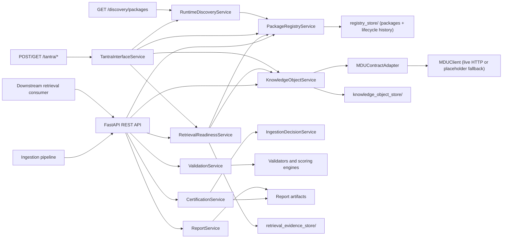
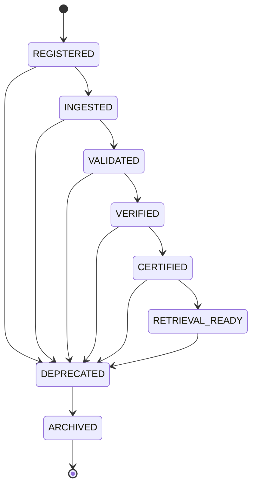
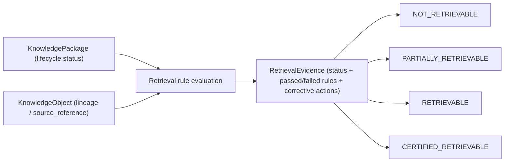

# MASTERDB — Core Knowledge Platform

Backend service for MASTERDB: deterministic dataset validation/certification
**plus** the Knowledge Package Lifecycle, Provenance/Lineage, and Retrieval
Readiness runtime that turns certification into a usable knowledge platform.


This repository started as a CSV integrity checker, became a validation and
certification boundary, then owned package identity, lifecycle state,
lineage relationships, and retrieval eligibility for the BHIV ecosystem —
and now exposes that platform as a live ecosystem capability: a real MDU
client, a MASTERDB <-> TANTRA runtime interface, and a Runtime Discovery
API, on top of the same lifecycle/lineage/retrieval logic. Canonical
schemas, ontology, and runtime reasoning remain out of scope and are owned
by MDU (Nupur) — see `MDU_INTERFACE_CONTRACT.md`.

This repo also hosts the BCAES Canonical Registry (`/bcaes/*`, ecosystem
product/capability/service catalog + production convergence tracking +
live reality snapshot) — see `BCAES_REGISTRY_ARCHITECTURE.md` for the full
design; that document is the source of truth for it.

It also hosts the BCAB/BCAES Canonical Document Repository
(`/canonical-repository/*`) — versioned, access-controlled storage for
the actual BCAB/BCAES documents (currently placeholder content, pending
central population) — see `CANONICAL_REPOSITORY_ARCHITECTURE.md`.

Production hardening (real JWT auth, RBAC enforcement, opt-in disk
persistence, audit logging, health/readiness endpoints) is tracked in
`PRODUCTION_HARDENING.md`, including what's still not done and why.

MASTERDB's constitutional identity, authority boundaries, runtime
position, adjacent-service contract status, and current evidence/replay/
observability state are documented in
`CONSTITUTIONAL_RUNTIME_DEFINITION.md`.

MASTERDB's real database backend (SQLAlchemy, SQLite for dev / Postgres
for production, opt-in via `MASTERDB_DATABASE_URL`) is documented in
`DATABASE.md`, including why external services reach this data through
the authenticated API rather than raw database credentials.

The full set of ecosystem endpoint URLs shared 6 Aug 2026 — which are
confirmed live, which are ambiguous, which are internal-only, which are
unresolved placeholders — is recorded in `ECOSYSTEM_ENDPOINTS.md`.

This repo also attaches the certification pipeline above to the 8
MASTERDB target databases (VectorDB, GraphDB, MetadataDB, DocumentDB,
TimeSeriesDB, RelationalDB, ArchiveDB, AnalyticsDB) as a controlled
ingestion facility for the MASTERDB Dashboard & Control Center
(`GET /databases`, `POST /ingest`, `GET /ingest/jobs*`) — see
`DATABASE_TARGETS_ARCHITECTURE.md` for the full contract, RBAC model, and
control chain.


## Scope


Owned by this  service:

- Dataset validation
- Certification state transitions
- MASTERDB ingestion eligibility decisions
- Validation reports and audit artifacts
- Knowledge Package Lifecycle (Dataset Registry)
- Source Registry (`/sources/*` — Source management, duplicate checking, unverified metadata tracking)
- Capability Registry (`/capabilities/*` — Capability discovery, contract resolution, access requests & governed retrieval)
- Geospatial Source-Independent Connector Adapter (`/connectors/geospatial/*` — Ingest pipeline: Source -> Connector -> Validation -> MDU -> Dataset -> Capability)
- Package Identity & Runtime Discovery

- Knowledge Object / Provenance consumption (adapter boundary to MDU, live
  when configured, placeholder-safe fallback otherwise)
- Retrieval Readiness & Retrieval Evidence
- Capability registration, discovery/search, immutable version history,
  access authorization, and contract/retrieval APIs (`/capabilities/*`)
- Restricted GEO-QUEST candidate registration and snapshot retrieval
  (`/geo-quest/candidates/*`); candidate remains non-canonical and
  non-discoverable pending formal governance authorization
- See `CAPABILITY_REGISTRY_API.md` for endpoint details and GEO-QUEST
  candidate governance constraints
- MASTERDB <-> TANTRA Runtime Interface (`/tantra/*`)
- Runtime Discovery API (`/discovery/packages`)
- Replay consistency & audit completeness (`/packages/{id}/replay`,
  `/packages/{id}/audit`)
- REST API for ingestion pipelines and downstream retrieval consumers
- Shared Data Service Registry & shared operational data platform
  (`/shared/*` — Authentication, Identity, Organizations, Configuration,
  Knowledge References, Notifications; see
  `MASTERDB_SHARED_DATA_ARCHITECTURE.md`)


Out of scope (owned elsewhere):

- Canonical schemas / ontology definitions (MDU)
- Knowledge authority / governance (MDU)
- Provenance & lineage semantics (MDU; MASTERDB only consumes them)
- Runtime reasoning
- Embeddings
- Vector databases
- RAG
- UI or application orchestration

## Architecture



## Package Lifecycle



Every hop records a timestamp, actor, and reason (`PackageRegistryService`),
rejects any edge not in the graph above, and can be replayed end-to-end via
`PackageRegistryService.replay()`.

## Retrieval Readiness Flow



`RETRIEVAL_READY` lifecycle status is necessary but not sufficient —
`CERTIFIED_RETRIEVABLE` also requires complete metadata and a registered
Knowledge Object with lineage. Every assessment is stored in
`retrieval_evidence_store/` and can be re-fetched via
`GET /packages/{package_id}/retrieval`.

## Certification States

The certification engine uses deterministic, auditable transitions:

- `NEW`
- `VALIDATED`
- `VERIFIED`
- `CERTIFIED`
- `REJECTED`

`VALIDATED` means all validation checks completed and report artifacts were produced.

`VERIFIED` means the dataset clears minimum score, metadata, provenance, integrity, and risk gates.

`CERTIFIED` means the dataset is trusted, has no risk flags, and has no open recommendations. Only this state is eligible for MASTERDB ingestion.

`REJECTED` means one or more certification gates failed. Rejection reasons are returned in the decision payload.

## Install

```bash
python -m pip install -r requirements.txt
```

To enable live MDU integration (Phase 1), set these environment variables
before starting the app; without them, MDU-dependent endpoints degrade to
the documented placeholder behavior rather than failing:

```bash
export MDU_BASE_URL="https://bhiv-mdu-api.onrender.com"
export MDU_API_KEY="<the shared key>"
```

## Persistence & Production Configuration

In development and test environments (`ENVIRONMENT` unset or non-production), MASTERDB runs with in-memory storage by default for isolated, ephemeral sessions (all state is reset on process restart).

In production mode (`ENVIRONMENT=production`, `APP_ENV=production`, or `MASTERDB_ENV=production`), fail-closed startup validation enforces that persistent storage is configured. Startup will fail with a sanitized configuration error if persistence is unconfigured or explicitly ephemeral (such as SQLite `:memory:`).

Supported storage configuration options (in order of precedence):

1. **Relational Database (`MASTERDB_DATABASE_URL`)** [Takes priority]:
   Any SQLAlchemy-compatible persistent connection string:
   ```bash
   # PostgreSQL (recommended for production deployments)
   export MASTERDB_DATABASE_URL="postgresql://<db_user>:<db_password>@<db_host>:5432/<db_name>"

   # File-based SQLite (local persistent storage)
   export MASTERDB_DATABASE_URL="sqlite:///var/data/masterdb.sqlite"
   ```
2. **Persistent Storage Directory (`MASTERDB_STORAGE_DIR`)** [Fallback if database URL unset]:
   A directory path on a persistent disk or volume for JSON file-backed storage:
   ```bash
   export MASTERDB_STORAGE_DIR="/var/data/masterdb_storage"
   ```

*Note: On ephemeral hosting providers (such as Render without persistent Disks), configure a persistent database (`MASTERDB_DATABASE_URL`) or attach a persistent disk to `MASTERDB_STORAGE_DIR` to ensure data survives across restarts.*

## Run API

```bash
uvicorn main:app --reload
```

OpenAPI documentation is available at:

- `http://127.0.0.1:8000/docs`
- `http://127.0.0.1:8000/openapi.json`

## Example Requests

Validate a dataset:

```bash
curl -X POST http://127.0.0.1:8000/validate \
  -H "Content-Type: application/json" \
  -d "{\"dataset_id\":\"sample-certified\",\"dataset_path\":\"certifiable_sample.csv\",\"metadata_path\":\"metadata.json\"}"
```

Certify a validated dataset:

```bash
curl -X POST http://127.0.0.1:8000/certify \
  -H "Content-Type: application/json" \
  -d "{\"dataset_id\":\"sample-certified\"}"
```

Get status:

```bash
curl http://127.0.0.1:8000/status/sample-certified
```

Get full report:

```bash
curl http://127.0.0.1:8000/report/sample-certified
```

## Registry / Knowledge Platform Examples

Register a package:

```bash
curl -X POST http://127.0.0.1:8000/packages/register \
  -H "Content-Type: application/json" \
  -d "{\"dataset_id\":\"sample-certified\",\"dataset_version\":\"1.0.0\",\"schema_version\":\"2\",\"board\":\"AI\",\"medium\":\"text\",\"language\":\"en\",\"owner\":\"kavy\",\"actor\":\"pipeline\",\"reason\":\"Initial registration.\"}"
```

Promote it through the lifecycle:

```bash
curl -X POST http://127.0.0.1:8000/packages/promote \
  -H "Content-Type: application/json" \
  -d "{\"package_id\":\"<package_id>\",\"to_status\":\"INGESTED\",\"actor\":\"pipeline\",\"reason\":\"Ingestion complete.\"}"
```

Register a Knowledge Object (lineage) for it:

```bash
curl -X POST http://127.0.0.1:8000/packages/<package_id>/knowledge-object \
  -H "Content-Type: application/json" \
  -d "{\"package_id\":\"<package_id>\",\"source_reference\":\"s3://bucket/source.csv\",\"derivation_path\":[\"ingest\"]}"
```

Check retrieval readiness:

```bash
curl http://127.0.0.1:8000/packages/<package_id>/retrieval
```

## Ecosystem Integration Examples

Check MDU schema compatibility for a registered package:

```bash
curl "http://127.0.0.1:8000/mdu/schema-compatibility/BHIV-DS-MARITIME-AIS-LIVE-001?local_schema_version=1.0"
```

Register a dataset via the TANTRA runtime interface:

```bash
curl -X POST http://127.0.0.1:8000/tantra/datasets/register \
  -H "Content-Type: application/json" \
  -d "{\"dataset_id\":\"BHIV-DS-MARITIME-AIS-LIVE-001\",\"dataset_version\":\"1.0\",\"schema_version\":\"1.0\",\"board\":\"maritime\",\"medium\":\"ais\",\"language\":\"en\",\"owner\":\"nupur\"}"
```

Runtime package lookup (bundled lifecycle + lineage + retrieval + certification):

```bash
curl http://127.0.0.1:8000/tantra/packages/<package_id>/runtime
```

Discover packages by board and lifecycle status:

```bash
curl "http://127.0.0.1:8000/discovery/packages?board=maritime&status=CERTIFIED"
```

## Database Targets — Controlled Ingestion Examples

Discover the 8 MASTERDB target databases (auth required):

```bash
curl http://127.0.0.1:8000/databases \
  -H "Authorization: Bearer <token>"
```

Ingest a CERTIFIED dataset into a specific target database:

```bash
curl -X POST http://127.0.0.1:8000/ingest \
  -H "Authorization: Bearer <token>" \
  -H "Content-Type: application/json" \
  -d "{\"dataset_id\":\"sample-certified\",\"target_database\":\"RelationalDB\",\"source_format\":\"csv\"}"
```

Check an ingestion job:

```bash
curl http://127.0.0.1:8000/ingest/jobs/<job_id> \
  -H "Authorization: Bearer <token>"
```

See `DATABASE_TARGETS_ARCHITECTURE.md` for the RBAC roles required per
database and the full control chain (RBAC -> format -> certification gate
-> routed).

Check replay consistency and audit completeness:

```bash
curl http://127.0.0.1:8000/packages/<package_id>/replay
curl http://127.0.0.1:8000/packages/<package_id>/audit
```

See `API_DOCUMENTATION.md` for the full endpoint reference.

## Operational Configuration & Production Hardening

### 1. Environment Modes & Safety Gates

- **Production Mode (`ENVIRONMENT=production` or `APP_ENV=production`):**
  - **Fail-Closed JWT Secret:** `AUTH_JWT_SECRET` must be set with at least 32 characters and cannot match known defaults. The service raises `RuntimeError` and refuses to boot if unset or insecure.
  - **Fail-Closed Persistence:** Storage must be explicitly configured via `MASTERDB_DATABASE_URL` or `MASTERDB_STORAGE_DIR`. Ephemeral storage (such as `sqlite:///:memory:` or `mode=memory`) is strictly prohibited and halts startup.
- **Development / Test Mode (`ENVIRONMENT=development` or unset):**
  - Generates a per-process ephemeral JWT secret if unset (with explicit console warnings).
  - Defaults to isolated in-memory or temporary storage for local experimentation.

### 2. Environment Variables Summary

| Variable Name | Required in Production | Description / Behavior |
| :--- | :---: | :--- |
| `ENVIRONMENT` / `APP_ENV` | Optional | Set to `production` to activate production safety gates. |
| `AUTH_PASSWORD` | **Yes** | Standard user password for `POST /auth/token`. If unset, authentication fails closed and no standard tokens are issued. |
| `ADMIN_PASSWORD` | **Yes** | Dedicated administrative credential required to issue tokens with `bhiv-admin` or `admin` roles. Must differ from `AUTH_PASSWORD`. |
| `AUTH_JWT_SECRET` | **Yes** | HMAC-SHA256 signing secret for JWTs ($\ge 32$ characters). Unset in production raises `RuntimeError`. |
| `MASTERDB_DATABASE_URL` | **Yes\*** | Primary database URL (`postgresql://...` or `sqlite:///path/to/file.db`). Ephemeral in-memory SQLite rejected in production. |
| `MASTERDB_STORAGE_DIR` | **Yes\*** | Filesystem storage directory for JSON persistence. Required if `MASTERDB_DATABASE_URL` is unset. |
| `MDU_BASE_URL` | Optional | Base URL for live MDU service. If unset, fallback placeholder contracts are safely used (`/mdu/status` reports `live: false`). |
| `MDU_API_KEY` | Optional | API key for authenticated MDU communication. |
| `PRAVAH_BHIV_BUCKET` | Optional | Object store endpoint for evidence/bucket storage. If unset, `/bucket/*` endpoints report unavailable (HTTP 503). |
| `PRAVAH_BHIV_INSIGHT_FLOW_BRIDGE` | Optional | Endpoint for telemetry/observability event publishing. If unset, `/observability/push-to-insightbridge` returns `pushed: false`. |
| `RATE_LIMIT_MAX_REQUESTS` | Optional | Maximum requests allowed per window (default: 120). Health/readiness probes are exempt. |
| `RATE_LIMIT_WINDOW_SECONDS` | Optional | Rate limit sliding window duration in seconds (default: 60). |

*\* Either `MASTERDB_DATABASE_URL` or `MASTERDB_STORAGE_DIR` must be configured in production.*

### 3. Authentication & Credential Separation

Token issuance via `POST /auth/token` enforces strict role segregation:
- **Standard Users:** Authenticate using `AUTH_PASSWORD`. The service issues JWTs granting only standard unprivileged roles (e.g. `ingest:relationaldb`, `viewer`). Any request for privileged roles (`admin`, `bhiv-admin`) is automatically stripped.
- **Administrators:** Require dedicated `ADMIN_PASSWORD`. Grants administrative roles (`bhiv-admin`, `operator`, `admin`) required for administrative endpoints like `/admin/configuration`.
- **Rate Limiting:** Sliding-window rate limiter verifies token authenticity before tracking subject identity, preventing forgery-based rate limit exhaustion attacks.

### 4. Health & Readiness Probes

- **Liveness Probe (`GET /health`):**
  - Returns `{"status": "ok"}` with HTTP 200.
  - Verifies process responsiveness without external dependencies.
- **Readiness Probe (`GET /ready`):**
  - Returns `{"status": "ok", "checks": {"bcaes_registry": "ok", "canonical_repository": "ok", "persistence": "ok"}}` with HTTP 200 when storage is healthy.
  - Actively executes `ping()` against configured persistence backends.
  - Returns HTTP 503 `{"status": "degraded", ...}` if storage connectivity fails, without leaking connection strings or credentials.

### 5. Running Verification & Test Suites

Execute test suites from the repository root using the virtual environment:

```bash
# Focused Persistence Security Suite (21 tests)
.\venv\Scripts\pytest -q tests/test_persistence_security.py

# Focused Authentication Security Suite (20 tests)
.\venv\Scripts\pytest -q tests/test_authentication_security.py

# Focused E2E Core Flow & Fresh Session Persistence (2 tests)
.\venv\Scripts\pytest -q tests/test_real_e2e_flow.py tests/test_fresh_session_persistence.py

# Full Repository Test Suite (445 tests)
.\venv\Scripts\pytest -q
```

### 6. Known Limitations & Unconfigured External Dependencies

- **MDU (`MDU_BASE_URL`):** When unset, MDU endpoints operate in contract-compatible fallback mode.
- **Pravah Bucket (`PRAVAH_BHIV_BUCKET`):** When unset, `/bucket/*` and `/evidence/*` fail closed with HTTP 503 rather than silently mocking storage.
- **InsightBridge (`PRAVAH_BHIV_INSIGHT_FLOW_BRIDGE`):** When unset, observability push reports `pushed: false` gracefully.

## Project Structure

```text
config/                 Validation schema and rule configuration
database_targets/       MASTERDB database routing / controlled ingestion
                        attachment (8 target databases, RBAC, contract) —
                        see DATABASE_TARGETS_ARCHITECTURE.md
datasets/               Sample valid and invalid dataset packages
engines/                Scoring, risk, classification, recommendation engines
profiling/              Dataset profiling
shared_data/            Phase 1 — canonical Shared Data Service Registry (Task 4)
services/               Service layer: validation, certification, registry,
                        knowledge object/provenance, retrieval readiness,
                        MDU client + contract adapter, TANTRA runtime
                        interface, runtime discovery, shared data platform
                        (shared record engine, six service contracts,
                        dependency resolver, version compatibility)
tests/                  Unit and integration tests
validators/             Deterministic validation checks
main.py                 FastAPI entrypoint only
models.py               API, decision, registry/knowledge-platform, and
                        shared-record models
reports/                Generated validation/certification report artifacts
registry_store/         Package registry records + lifecycle history
knowledge_object_store/ Knowledge Object / provenance records
retrieval_evidence_store/  Retrieval readiness evidence artifacts
shared_store/           Shared dataset records (authentication, identity,
                        organizations, configuration, knowledge_references,
                        notifications), one subfolder per dataset
```

## Key Artifacts

- `reports/sample-certified.json`
- `reports/sample-rejected.json`
- `API_DOCUMENTATION.md`
- `ARCHITECTURE.md`
- `REVIEW_PACKET.md`
- `HANDOVER.md`
- `MDU_INTERFACE_CONTRACT.md`
- `MASTERDB_SHARED_DATA_ARCHITECTURE.md`
- `DATABASE_TARGETS_ARCHITECTURE.md`

## Task 4 — Shared Data Services & MASTERDB Convergence

MASTERDB additionally exposes a **shared operational data platform** layer
(`/shared/*`) sitting between Product Databases and MDU: a canonical
registry of 15 reusable ecosystem dataset categories
(`shared_data/registry.py`), six live shared service contracts
(Authentication, Identity, Organizations, Configuration, Knowledge
References, Notifications), and version-aware, replay-safe, auditable
runtime APIs for all of them. This is additive to everything above — it
does not change certification, lifecycle, lineage, retrieval, or the
TANTRA/discovery surfaces. Full design, dependency mapping, and runtime
flows: **`MASTERDB_SHARED_DATA_ARCHITECTURE.md`**.

```text
shared_data/            Phase 1 — canonical shared dataset registry (data-only module)
services/shared_*        Phase 2/4/5 — generic record engine, six service
                         contracts, cross-service dependency resolver,
                         version-compatibility utility
shared_store/            Per-dataset JSON record storage (created on first use)
```
