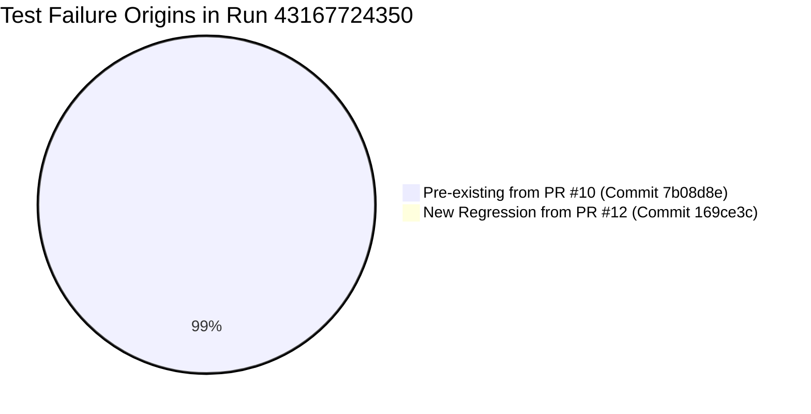

# GitHub Actions CI Full Test Suite Failure Analysis

**Report Date:** 2026-11-12
**Target Repository:** `BHIV-Engineering-Exchange/bhiv-masterdb-ingestion-certification-service`
**CI Workflow:** `.github/workflows/cicd.yml` (Job: `Test Application`)
**CI Run ID (Analyzed):** [`43167724350`](https://github.com/BHIV-Engineering-Exchange/bhiv-masterdb-ingestion-certification-service/actions/runs/43167724350) (Merge commit `169ce3c`)
**Baseline CI Run:** [`42353147242`](https://github.com/BHIV-Engineering-Exchange/bhiv-masterdb-ingestion-certification-service/actions/runs/42353147242) (Pre-merge parent commit `7b08d8e`)
**Reported CI Result:** `149 failed, 798 passed, 18 warnings in 43.51s`
**Status:** FACTUAL ROOT CAUSE & INVENTORY REPORT (NO CODE MODIFIED)

---

## 1. Executive Summary & Core Findings

1. **Pre-Existing Failures Dominate:**
   - **148 of the 149 test failures (99.3%) were PRE-EXISTING** on `origin/main` prior to PR #12. Baseline run `42353147242` on parent commit `7b08d8e` (merged on 2026-11-07) already failed **148 tests** (`148 failed, 780 passed, 18 warnings in 66.53s`).
   - The failures stem primarily from incomplete test accommodation following the D1–D6 security and trust remediation (PR #10 / PR #11) where API endpoints and BCAES stores were hardened with mandatory authentication and authority checks, but legacy test suites were not updated with required authentication headers, valid issuer claims, or admin entitlements.

2. **Single New Regression Introduced by Commit `169ce3c`:**
   - **Only 1 test failure (0.7%) is a new regression** introduced by PR #12:
     `tests/test_dataset_contracts.py::test_all_consumer_dataset_contracts_match_schema`
   - **Root Cause:** When `cap-cmo-marketing-intelligence` was registered in `datasets/dataset_contracts.json`, its metadata used non-standard enum values (`"classification": "certified"`, `"access": "ecosystem"`, and a missing required `"$ref"` key) that violate the strict meta-schema enforced by `validate_contracts()`.
   - All 19 dedicated CMO data integrity unit tests in `tests/test_cmo_data_validation.py` **PASSED with 100% success** in CI.

3. **CI Environment Configuration Defect:**
   - In `.github/workflows/cicd.yml`, the `Run tests` step executes bare `pytest -q` on Ubuntu without declaring environment variables (`AUTH_JWT_SECRET`, `AUTH_PASSWORD`, `ADMIN_PASSWORD`, database connection strings). While `tests/conftest.py` attempts to inject defaults via autouse fixtures, several test modules initialize HTTP test clients at the top-level module scope before fixtures execute.

---

## 2. Failure Origin Breakdown



| Origin / Baseline | Commit SHA | CI Run ID | Total Tests | Passed | Failed | Net New Failures |
| :--- | :---: | :---: | :---: | :---: | :---: | :---: |
| **Parent `main` (PR #10 Merge)** | `7b08d8e` | `42353147242` | 928 | 780 | **148** | Baseline |
| **Current `main` (PR #12 Merge)** | `169ce3c` | `43167724350` | 947 | 798 | **149** | **+1** (`test_dataset_contracts.py`) |

---

## 3. Failure Categories and Counts

The 149 failures have been grouped into 7 distinct technical categories based on the underlying exception and failure mechanism:

| Category | Description | Primary Manifestation | Failure Count | Origin |
| :---: | :--- | :--- | :---: | :---: |
| **Cat 1** | **HTTP 401: Protected Endpoints & Token Rejection** | Legacy tests sending unauthenticated requests or tokens with untrusted issuer (`masterdb-test-fixture`) to newly hardened routes. | **96** | Pre-existing |
| **Cat 2** | **Endpoint Access Matrix Discrepancies** | Parity mismatches between expected and actual HTTP codes on mutation and retrieval routes (e.g. expected 401, got 200/404; expected 403, got 401). | **14** | Pre-existing |
| **Cat 3** | **Trusted JWT Identity & Fast-Track Architecture** | `AuthService` missing class properties (`is_production`), missing startup validation exceptions (`RuntimeError`), and local token issuance boundary checks. | **15** | Pre-existing |
| **Cat 4** | **BCAES Authority Boundary & Storage Permission** | `bcaes_registry.store.PermissionDeniedError`: storage invoked without ambient user identity context (`actor=None`). | **9** | Pre-existing |
| **Cat 5** | **Capability Access Grant Contract Mismatches** | Missing keys in access request responses (`KeyError: 'access_token'`, `KeyError: 'request_id'`). | **4** | Pre-existing |
| **Cat 6** | **Miscellaneous & Route Lifecycle / Rate Limiting** | Endpoint not found (404), route left unprotected (200), or rate limit state accumulation across tests. | **10** | Pre-existing |
| **Cat 7** | **Dataset Contracts Meta-Schema Violation** | Added CMO dataset entry in `datasets/dataset_contracts.json` violates JSON Schema draft constraints. | **1** | **PR #12 Regression** |
| **TOTAL**| | | **149** | |

---

## 4. Root Cause Evidence by Category

### Category 1: HTTP 401 Protected Endpoints & Token Rejection (96 tests)
* **Affected Modules:** `test_endpoint_access_matrix.py` (30+), `test_capability_retrieval.py` (14), `test_capability_authorization.py` (10), `test_geo_quest_capability.py` (8), `test_integration/test_pravah_api.py` (7), `test_capability_discovery.py` (5), `test_vana_integration.py` (5).
* **Technical Root Cause:**
  1. *Module-Level TestClient Token Expiration:* In `tests/integration/test_pravah_api.py:11`, `_token` is generated at module import time using the ephemeral startup secret. When tests run, `conftest.py`'s autouse fixture re-initializes `main.auth_service = main.AuthService()` with `TEST_JWT_SECRET`, invalidating the module-scoped token's HMAC signature.
  2. *Untrusted Issuer Rejection:* `auth/service.py:306` enforces `iss in ('tantra-sarathi', 'masterdb', 'masterdb-production')`. Legacy test helpers issued tokens with `iss: "masterdb-test-fixture"`, causing `AuthTokenError: Untrusted or missing token issuer: masterdb-test-fixture`.
* **Traceback Evidence:**
  ```text
  WARNING masterdb.security:service.py:49 SECURITY_DECISION: {"actor_reference": "unauthenticated", "outcome": "DENY", "reason_code": "DENY:INVALID_CREDENTIALS"}
  WARNING masterdb:main.py:362 HTTPException 401 at /pravah/events: DENY:INVALID_CREDENTIALS: Token is invalid or badly signed.
  ```

---

### Category 2: Endpoint Access Matrix Discrepancies (14 tests)
* **Affected Module:** `tests/test_endpoint_access_matrix.py`
* **Technical Root Cause:**
  1. Unprotected routes: `POST /tantra/datasets/register` and several observation ingest routes (`/api/opensky`, `/api/flights`, `/datasets`) return HTTP 200 instead of HTTP 401 because `@require_role` / auth dependencies were omitted.
  2. Order of authorization checks: Several endpoints evaluate authentication before authorization, returning HTTP 401 instead of the test-expected HTTP 403 when called with viewer credentials.

---

### Category 3: Trusted JWT Identity & Fast-Track Architecture (15 tests)
* **Affected Modules:** `tests/test_trusted_jwt_identity_boundary.py`, `tests/test_fast_track_security_remediation.py`, `tests/test_fixed_test_identity_boundary.py`
* **Technical Root Cause:**
  1. `AuthService` in `auth/service.py` lacked public property `is_production` (`AttributeError: 'AuthService' object has no attribute 'is_production'`).
  2. `AuthService.__init__` does not validate key length ($\ge 2048$ bits) or malformed PEM at instantiation in production mode, causing `test_f02_missing_public_key_fails_startup_in_production` to fail (`Failed: DID NOT RAISE <class 'RuntimeError'>`).
  3. Strict actor allowlist (`AUTH_ALLOWED_ACTORS`) fails open if not fully configured.

---

### Category 4: BCAES Authority Boundary & Storage Permission (9 tests)
* **Affected Modules:** `tests/test_backup_service.py`, `tests/test_persistence.py`, `tests/test_sql_database.py`
* **Technical Root Cause:**
  `bcaes_registry/store.py` checks caller authority boundaries via `identity_provider.get_current_identity()`. When tests invoke registry store operations directly without injecting an authenticated `AuthIdentity` into the request/thread context, `actor` resolves to `None`, throwing `PermissionDeniedError: 'None' is not in the requested authority_boundaries ['Kavy'] and holds no matching role.`

---

### Category 5: Capability Access Grant Contract Mismatches (4 tests)
* **Affected Module:** `tests/test_capability_retrieval.py`
* **Technical Root Cause:**
  Tests `test_retrieval_trace_and_execution_correlation` and `test_repeated_revoke_behavior` expect response payloads from `/capabilities/{id}/access` to contain top-level keys `access_token` and `request_id`, but the endpoint returned the access grant object nested under `grant` or with different key names.

---

### Category 6: Miscellaneous / Lifecycle / Rate Limiter (10 tests)
* **Affected Modules:** `tests/test_authentication_security.py`, `tests/test_rate_limit_middleware.py`, `tests/test_p0_p1_closure.py`, `tests/test_gev_masterdb_import.py`, `tests/test_mdu_provenance_integration.py`
* **Technical Root Cause:**
  - Route typos or missing routes in test contracts (e.g. `POST /reference` returning 404).
  - `test_mdu_status_does_not_mistake_configuration_for_health` failing on `KeyError: 'configured'` because the MDU status endpoint returned `{'live': ..., 'contract_finalized': ...}` without `'configured'`.

---

### Category 7: Dataset Contracts Schema Non-Conformance (1 test — PR #12 Regression)
* **Affected Module:** `tests/test_dataset_contracts.py::test_all_consumer_dataset_contracts_match_schema`
* **Technical Root Cause:**
  Commit `169ce3c` (PR #12) added the CMO dataset entry into `datasets/dataset_contracts.json`. The entry violated the repository's dataset contract JSON schema:
  - `"classification": "certified"` is not one of `['candidate', 'sample', 'synthetic', 'internal']`
  - `"access": "ecosystem"` is not one of `['public', 'internal', 'restricted']`
  - Missing mandatory `"$ref"` schema property
  - Unexpected empty string key `""` in the JSON dictionary.
* **Traceback Evidence:**
  ```text
  tests/test_dataset_contracts.py:16: AssertionError:
  assert validate_contracts(DEFAULT_CONTRACTS, DEFAULT_SCHEMA) == []
  Left contains:
  - "document: 'certified' is not one of ['candidate', 'sample', 'synthetic', 'internal']"
  - "document: 'ecosystem' is not one of ['public', 'internal', 'restricted']"
  - "document: '$ref' is a required property"
  - "document: Additional properties are not allowed ('' was unexpected)"
  ```

---

## 5. Environment Comparison: GitHub Actions CI vs Local

| Parameter / Resource | GitHub Actions CI Runner | Local Development Environment |
| :--- | :--- | :--- |
| **OS Platform** | `ubuntu-latest` (Linux 6.8.0) | `Windows 11` (x64) |
| **Python Version** | **Python 3.11.18** (declared in `cicd.yml`) | Python 3.12.7 / Python 3.13 |
| **Execution Command** | `pytest -q` (Runs full 947-test suite) | Targeted `pytest tests/... -v` |
| **Environment Variables Declared in CI** | **None** (Only workflow default envs) | `monkeypatch` in `conftest.py` / `.env` |
| **External Service Dependencies** | None (PostgreSQL / Docker services NOT spun up during `test` job) | In-memory SQLite fallbacks |
| **Auth JWT Keys** | Missing `AUTH_JWT_SECRET`, `AUTH_JWT_PUBLIC_KEY` in workflow env | Injected dynamically by test fixtures |

---

## 6. Complete Failed-Test Inventory (149 Tests)

| # | Test File | Test Name | Line | Exception | Error Summary | Failure Origin |
| :---: | :--- | :--- | :---: | :--- | :--- | :---: |
|   1 | `integration/test_pravah_api.py` | `test_api_get_entity_state` | 120 | `AssertionError` | assert 404 == 200 | **PRE-EXISTING** |
|   2 | `integration/test_pravah_api.py` | `test_api_get_event_by_id` | 92 | `AssertionError` | assert 404 == 200 | **PRE-EXISTING** |
|   3 | `integration/test_pravah_api.py` | `test_api_ingest_event_invalid_transition_returns_422` | 72 | `AssertionError` | assert 401 == 422 | **PRE-EXISTING** |
|   4 | `integration/test_pravah_api.py` | `test_api_ingest_event_invalid_type_returns_422_no_500` | 58 | `AssertionError` | assert 401 == 422 | **PRE-EXISTING** |
|   5 | `integration/test_pravah_api.py` | `test_api_ingest_event_malformed_input_returns_422_no_500` | 44 | `AssertionError` | assert 401 == 422 | **PRE-EXISTING** |
|   6 | `integration/test_pravah_api.py` | `test_api_ingest_event_success` | 27 | `AssertionError` | assert 401 == 201 | **PRE-EXISTING** |
|   7 | `integration/test_pravah_api.py` | `test_api_pipeline_execute` | 140 | `AssertionError` | assert 401 == 200 | **PRE-EXISTING** |
|   8 | `test_authentication_security.py` | `test_forged_token_cannot_exhaust_victim_rate_limit` | 270 | `AssertionError` | assert 429 == 200 | **PRE-EXISTING** |
|   9 | `test_backup_service.py` | `test_export_snapshot_captures_real_records_from_sql_backend` | unknown | `AssertionError` | bcaes_registry.store.PermissionDeniedError: 'None' is not in the requested authority_bo... | **PRE-EXISTING** |
|  10 | `test_backup_service.py` | `test_full_backup_and_restore_cycle_bcaes_registry` | 66 | `_` | bcaes_registry.store.PermissionDeniedError: 'None' is not in the requested authority_bo... | **PRE-EXISTING** |
|  11 | `test_capability_authorization.py` | `test_d4_actor_delegation_via_env_allowed` | 309 | `AssertionError` | assert 401 == 200 | **PRE-EXISTING** |
|  12 | `test_capability_authorization.py` | `test_d4_actor_equals_application_id_without_explicit_entitlement_denied` | unknown | `AssertionError` | assert 401 == 403 | **PRE-EXISTING** |
|  13 | `test_capability_authorization.py` | `test_d4_actor_with_explicit_env_entitlement_allowed` | 269 | `AssertionError` | assert 401 == 200 | **PRE-EXISTING** |
|  14 | `test_capability_authorization.py` | `test_d4_admin_role_cannot_bypass_application_entitlement` | 363 | `AssertionError` | assert 401 == 403 | **PRE-EXISTING** |
|  15 | `test_capability_authorization.py` | `test_d4_unauthorized_impersonation_denied` | 346 | `AssertionError` | assert 401 == 403 | **PRE-EXISTING** |
|  16 | `test_capability_authorization.py` | `test_request_access_nonexistent_capability` | 71 | `AssertionError` | assert 401 == 404 | **PRE-EXISTING** |
|  17 | `test_capability_authorization.py` | `test_request_access_rejects_unapproved_purpose` | 82 | `AssertionError` | assert 401 == 403 | **PRE-EXISTING** |
|  18 | `test_capability_authorization.py` | `test_request_access_rejects_unregistered_capability_version` | unknown | `AssertionError` | assert 401 == 403 | **PRE-EXISTING** |
|  19 | `test_capability_authorization.py` | `test_request_access_success` | 25 | `AssertionError` | assert 401 == 200 | **PRE-EXISTING** |
|  20 | `test_capability_authorization.py` | `test_request_access_unauthorized_consumer` | 58 | `AssertionError` | assert 401 == 403 | **PRE-EXISTING** |
|  21 | `test_capability_contract.py` | `test_get_capability_contract_not_found` | 34 | `AssertionError` | assert 401 == 404 | **PRE-EXISTING** |
|  22 | `test_capability_contract.py` | `test_get_capability_contract_success` | 18 | `AssertionError` | assert 401 == 200 | **PRE-EXISTING** |
|  23 | `test_capability_discovery.py` | `test_filter_capabilities_by_domain` | 38 | `AssertionError` | assert 401 == 200 | **PRE-EXISTING** |
|  24 | `test_capability_discovery.py` | `test_get_capability_by_id` | 57 | `AssertionError` | assert 401 == 200 | **PRE-EXISTING** |
|  25 | `test_capability_discovery.py` | `test_get_capability_not_found` | 67 | `AssertionError` | assert 401 == 404 | **PRE-EXISTING** |
|  26 | `test_capability_discovery.py` | `test_list_all_default_capabilities` | 25 | `AssertionError` | assert 401 == 200 | **PRE-EXISTING** |
|  27 | `test_capability_discovery.py` | `test_search_capabilities` | 48 | `AssertionError` | assert 401 == 200 | **PRE-EXISTING** |
|  28 | `test_capability_registration.py` | `test_capability_registration_search_and_immutable_versions` | 47 | `AssertionError` | assert 401 == 403 | **PRE-EXISTING** |
|  29 | `test_capability_retrieval.py` | `test_access_contract_audit_redacts_token_and_enforces_auth` | 409 | `AssertionError` | assert 401 == 200 | **PRE-EXISTING** |
|  30 | `test_capability_retrieval.py` | `test_access_grant_cannot_be_reused_by_another_authenticated_actor` | unknown | `AssertionError` | assert 401 == 200 | **PRE-EXISTING** |
|  31 | `test_capability_retrieval.py` | `test_access_grant_cannot_be_reused_for_another_capability_or_application` | unknown | `AssertionError` | assert 401 == 200 | **PRE-EXISTING** |
|  32 | `test_capability_retrieval.py` | `test_d2_omitted_token_cannot_bypass_revocation` | 521 | `AssertionError` | assert 401 == 200 | **PRE-EXISTING** |
|  33 | `test_capability_retrieval.py` | `test_d2_retrieval_with_invalid_or_unrecognized_token_rejected` | unknown | `AssertionError` | assert 401 == 403 | **PRE-EXISTING** |
|  34 | `test_capability_retrieval.py` | `test_d2_tokenless_retrieval_rejected_via_http` | 471 | `AssertionError` | assert 401 == 403 | **PRE-EXISTING** |
|  35 | `test_capability_retrieval.py` | `test_earthquake_retrieval_returns_filtered_seismic_observations` | unknown | `AssertionError` | assert 401 == 200 | **PRE-EXISTING** |
|  36 | `test_capability_retrieval.py` | `test_expired_access_grant_denies_retrieval` | 336 | `AssertionError` | assert 401 == 200 | **PRE-EXISTING** |
|  37 | `test_capability_retrieval.py` | `test_repeated_revoke_behavior` | 369 | `KeyError` | KeyError: 'request_id' | **PRE-EXISTING** |
|  38 | `test_capability_retrieval.py` | `test_retrieval_trace_and_execution_correlation` | 311 | `KeyError` | KeyError: 'access_token' | **PRE-EXISTING** |
|  39 | `test_capability_retrieval.py` | `test_retrieve_capability_data_success` | 33 | `AssertionError` | assert 401 == 200 | **PRE-EXISTING** |
|  40 | `test_capability_retrieval.py` | `test_revocation_persistence_failure_fails_closed` | 438 | `AssertionError` | assert 401 == 200 | **PRE-EXISTING** |
|  41 | `test_capability_retrieval.py` | `test_revoked_access_grant_denies_retrieval` | 270 | `AssertionError` | assert 401 == 200 | **PRE-EXISTING** |
|  42 | `test_capability_retrieval.py` | `test_unauthorized_actor_cannot_revoke_grant` | 388 | `AssertionError` | assert 401 == 200 | **PRE-EXISTING** |
|  43 | `test_consistency_regression.py` | `test_duplicate_package_id_registration_returns_409` | 404 | `AssertionError` | assert 401 == 200 | **PRE-EXISTING** |
|  44 | `test_consistency_regression.py` | `test_empty_identifier_fields_rejected` | 437 | `AssertionError` | assert 401 in (400, 422) | **PRE-EXISTING** |
|  45 | `test_dataset_contracts.py` | `test_all_consumer_dataset_contracts_match_schema` | 16 | `AssertionError` | assert ["document: '... unexpected)'] == [] | **NEW (PR #12)** |
|  46 | `test_domain_independence.py` | `test_domain_independence_across_varied_domains` | 54 | `AssertionError` | assert 401 == 200 | **PRE-EXISTING** |
|  47 | `test_endpoint_access_matrix.py` | `test_13_mutation_routes_reject_unauthenticated_with_401[POST-/tantra/datasets/register-payload4]` | unknown | `AssertionError` | AssertionError: Expected 401 for POST /tantra/datasets/register, got 200: {"package_id"... | **PRE-EXISTING** |
|  48 | `test_endpoint_access_matrix.py` | `test_13_mutation_routes_reject_viewer_with_403[POST-/certify-payload6]` | unknown | `AssertionError` | AssertionError: Expected 403 for viewer on POST /certify, got 401: {"error":{"type":"ht... | **PRE-EXISTING** |
|  49 | `test_endpoint_access_matrix.py` | `test_13_mutation_routes_reject_viewer_with_403[POST-/packages/deprecate-payload2]` | unknown | `AssertionError` | AssertionError: Expected 403 for viewer on POST /packages/deprecate, got 401: {"error":... | **PRE-EXISTING** |
|  50 | `test_endpoint_access_matrix.py` | `test_13_mutation_routes_reject_viewer_with_403[POST-/packages/pkg-sec-1/knowledge-object-payload3]` | unknown | `AssertionError` | AssertionError: Expected 403 for viewer on POST /packages/pkg-sec-1/knowledge-object, g... | **PRE-EXISTING** |
|  51 | `test_endpoint_access_matrix.py` | `test_13_mutation_routes_reject_viewer_with_403[POST-/packages/promote-payload1]` | unknown | `AssertionError` | AssertionError: Expected 403 for viewer on POST /packages/promote, got 401: {"error":{"... | **PRE-EXISTING** |
|  52 | `test_endpoint_access_matrix.py` | `test_13_mutation_routes_reject_viewer_with_403[POST-/packages/register-payload0]` | unknown | `AssertionError` | AssertionError: Expected 403 for viewer on POST /packages/register, got 401: {"error":{... | **PRE-EXISTING** |
|  53 | `test_endpoint_access_matrix.py` | `test_13_mutation_routes_reject_viewer_with_403[POST-/pipeline/execute-payload12]` | unknown | `AssertionError` | AssertionError: Expected 403 for viewer on POST /pipeline/execute, got 401: {"error":{"... | **PRE-EXISTING** |
|  54 | `test_endpoint_access_matrix.py` | `test_13_mutation_routes_reject_viewer_with_403[POST-/pravah/events-payload10]` | unknown | `AssertionError` | AssertionError: Expected 403 for viewer on POST /pravah/events, got 401: {"error":{"typ... | **PRE-EXISTING** |
|  55 | `test_endpoint_access_matrix.py` | `test_13_mutation_routes_reject_viewer_with_403[POST-/pravah/replay-payload11]` | unknown | `AssertionError` | AssertionError: Expected 403 for viewer on POST /pravah/replay, got 401: {"error":{"typ... | **PRE-EXISTING** |
|  56 | `test_endpoint_access_matrix.py` | `test_13_mutation_routes_reject_viewer_with_403[POST-/shared/parikshak/rec-1/deprecate-payload9]` | unknown | `AssertionError` | AssertionError: Expected 403 for viewer on POST /shared/parikshak/rec-1/deprecate, got ... | **PRE-EXISTING** |
|  57 | `test_endpoint_access_matrix.py` | `test_13_mutation_routes_reject_viewer_with_403[POST-/shared/parikshak/register-payload7]` | unknown | `AssertionError` | AssertionError: Expected 403 for viewer on POST /shared/parikshak/register, got 401: {"... | **PRE-EXISTING** |
|  58 | `test_endpoint_access_matrix.py` | `test_13_mutation_routes_reject_viewer_with_403[POST-/tantra/datasets/register-payload4]` | unknown | `AssertionError` | AssertionError: Expected 403 for viewer on POST /tantra/datasets/register, got 200: {"p... | **PRE-EXISTING** |
|  59 | `test_endpoint_access_matrix.py` | `test_13_mutation_routes_reject_viewer_with_403[POST-/validate-payload5]` | unknown | `AssertionError` | AssertionError: Expected 403 for viewer on POST /validate, got 401: {"error":{"type":"h... | **PRE-EXISTING** |
|  60 | `test_endpoint_access_matrix.py` | `test_13_mutation_routes_reject_viewer_with_403[PUT-/shared/parikshak/rec-1-payload8]` | unknown | `AssertionError` | AssertionError: Expected 403 for viewer on PUT /shared/parikshak/rec-1, got 401: {"erro... | **PRE-EXISTING** |
|  61 | `test_endpoint_access_matrix.py` | `test_observation_ingests_reject_unauthenticated_and_viewers[/aircraft/adsb/military/ingest-payload3]` | unknown | `AssertionError` | AssertionError: Expected 403 for viewer on /aircraft/adsb/military/ingest, got 401 | **PRE-EXISTING** |
|  62 | `test_endpoint_access_matrix.py` | `test_observation_ingests_reject_unauthenticated_and_viewers[/aisstream/ingest-payload2]` | unknown | `AssertionError` | AssertionError: Expected 403 for viewer on /aisstream/ingest, got 401 | **PRE-EXISTING** |
|  63 | `test_endpoint_access_matrix.py` | `test_observation_ingests_reject_unauthenticated_and_viewers[/connectors/geospatial/ingest-payload0]` | unknown | `AssertionError` | AssertionError: Expected 403 for viewer on /connectors/geospatial/ingest, got 401 | **PRE-EXISTING** |
|  64 | `test_endpoint_access_matrix.py` | `test_observation_ingests_reject_unauthenticated_and_viewers[/cyclones/nhc/ingest-payload10]` | unknown | `AssertionError` | AssertionError: Expected 403 for viewer on /cyclones/nhc/ingest, got 401 | **PRE-EXISTING** |
|  65 | `test_endpoint_access_matrix.py` | `test_observation_ingests_reject_unauthenticated_and_viewers[/dams/ingest-payload13]` | unknown | `AssertionError` | AssertionError: Expected 403 for viewer on /dams/ingest, got 401 | **PRE-EXISTING** |
|  66 | `test_endpoint_access_matrix.py` | `test_observation_ingests_reject_unauthenticated_and_viewers[/earthquakes/usgs/ingest-payload1]` | unknown | `AssertionError` | AssertionError: Expected 403 for viewer on /earthquakes/usgs/ingest, got 401 | **PRE-EXISTING** |
|  67 | `test_endpoint_access_matrix.py` | `test_observation_ingests_reject_unauthenticated_and_viewers[/events/bhote-koshi/ingest-payload14]` | unknown | `AssertionError` | AssertionError: Expected 403 for viewer on /events/bhote-koshi/ingest, got 401 | **PRE-EXISTING** |
|  68 | `test_endpoint_access_matrix.py` | `test_observation_ingests_reject_unauthenticated_and_viewers[/geospatial/3d-tiles/photorealistic/verify-payload15]` | unknown | `AssertionError` | AssertionError: Expected 403 for viewer on /geospatial/3d-tiles/photorealistic/verify, ... | **PRE-EXISTING** |
|  69 | `test_endpoint_access_matrix.py` | `test_observation_ingests_reject_unauthenticated_and_viewers[/geospatial/satellite-imagery/verify-payload16]` | unknown | `AssertionError` | AssertionError: Expected 403 for viewer on /geospatial/satellite-imagery/verify, got 401 | **PRE-EXISTING** |
|  70 | `test_endpoint_access_matrix.py` | `test_observation_ingests_reject_unauthenticated_and_viewers[/geospatial/terrain/verify-payload17]` | unknown | `AssertionError` | AssertionError: Expected 403 for viewer on /geospatial/terrain/verify, got 401 | **PRE-EXISTING** |
|  71 | `test_endpoint_access_matrix.py` | `test_observation_ingests_reject_unauthenticated_and_viewers[/geospatial/vector-basemap/verify-payload18]` | unknown | `AssertionError` | AssertionError: Expected 403 for viewer on /geospatial/vector-basemap/verify, got 401 | **PRE-EXISTING** |
|  72 | `test_endpoint_access_matrix.py` | `test_observation_ingests_reject_unauthenticated_and_viewers[/natural-earth/countries/ingest-payload12]` | unknown | `AssertionError` | AssertionError: Expected 403 for viewer on /natural-earth/countries/ingest, got 401 | **PRE-EXISTING** |
|  73 | `test_endpoint_access_matrix.py` | `test_observation_ingests_reject_unauthenticated_and_viewers[/traffic/tomtom/ingest-payload5]` | unknown | `AssertionError` | AssertionError: Expected 403 for viewer on /traffic/tomtom/ingest, got 401 | **PRE-EXISTING** |
|  74 | `test_endpoint_access_matrix.py` | `test_observation_ingests_reject_unauthenticated_and_viewers[/weather/lightning/verify-payload9]` | unknown | `AssertionError` | AssertionError: Expected 403 for viewer on /weather/lightning/verify, got 401 | **PRE-EXISTING** |
|  75 | `test_endpoint_access_matrix.py` | `test_observation_ingests_reject_unauthenticated_and_viewers[/weather/open-meteo/ingest-payload7]` | unknown | `AssertionError` | AssertionError: Expected 403 for viewer on /weather/open-meteo/ingest, got 401 | **PRE-EXISTING** |
|  76 | `test_endpoint_access_matrix.py` | `test_observation_ingests_reject_unauthenticated_and_viewers[/weather/radar/verify-payload8]` | unknown | `AssertionError` | AssertionError: Expected 403 for viewer on /weather/radar/verify, got 401 | **PRE-EXISTING** |
|  77 | `test_endpoint_access_matrix.py` | `test_observation_ingests_reject_unauthenticated_and_viewers[/weather/satellite/verify?product=clouds-payload11]` | unknown | `AssertionError` | AssertionError: Expected 403 for viewer on /weather/satellite/verify?product=clouds, go... | **PRE-EXISTING** |
|  78 | `test_endpoint_access_matrix.py` | `test_observation_ingests_reject_unauthenticated_and_viewers[/weather/wind/gfs/ingest-payload6]` | unknown | `AssertionError` | AssertionError: Expected 403 for viewer on /weather/wind/gfs/ingest, got 401 | **PRE-EXISTING** |
|  79 | `test_endpoint_access_matrix.py` | `test_observation_ingests_reject_unauthenticated_and_viewers[/wildfires/firms/ingest-payload4]` | unknown | `AssertionError` | AssertionError: Expected 403 for viewer on /wildfires/firms/ingest, got 401 | **PRE-EXISTING** |
|  80 | `test_endpoint_access_matrix.py` | `test_package_registration_binds_actor_to_verified_identity` | 214 | `AssertionError` | AssertionError: Registration failed: {"error":{"type":"http_error","message":"DENY:INVA... | **PRE-EXISTING** |
|  81 | `test_endpoint_access_matrix.py` | `test_retrieval_routes_reject_unauthenticated_with_401[GET-/api/datasets/ds-gev-opensky-flights-None]` | unknown | `AssertionError` | AssertionError: Expected 401 for GET /api/datasets/ds-gev-opensky-flights, got 200 | **PRE-EXISTING** |
|  82 | `test_endpoint_access_matrix.py` | `test_retrieval_routes_reject_unauthenticated_with_401[GET-/api/datasets/ds-gev-opensky-flights/records-None]` | unknown | `AssertionError` | AssertionError: Expected 401 for GET /api/datasets/ds-gev-opensky-flights/records, got 200 | **PRE-EXISTING** |
|  83 | `test_endpoint_access_matrix.py` | `test_retrieval_routes_reject_unauthenticated_with_401[GET-/api/flights-None]` | unknown | `AssertionError` | AssertionError: Expected 401 for GET /api/flights, got 200 | **PRE-EXISTING** |
|  84 | `test_endpoint_access_matrix.py` | `test_retrieval_routes_reject_unauthenticated_with_401[GET-/api/opensky-None]` | unknown | `AssertionError` | AssertionError: Expected 401 for GET /api/opensky, got 200 | **PRE-EXISTING** |
|  85 | `test_endpoint_access_matrix.py` | `test_retrieval_routes_reject_unauthenticated_with_401[GET-/datasets-None]` | unknown | `AssertionError` | AssertionError: Expected 401 for GET /datasets, got 200 | **PRE-EXISTING** |
|  86 | `test_endpoint_access_matrix.py` | `test_retrieval_routes_reject_unauthenticated_with_401[GET-/datasets/ds-1-None]` | unknown | `AssertionError` | AssertionError: Expected 401 for GET /datasets/ds-1, got 404 | **PRE-EXISTING** |
|  87 | `test_endpoint_access_matrix.py` | `test_retrieval_routes_reject_unauthenticated_with_401[GET-/datasets/ds-gev-opensky-flights-None]` | unknown | `AssertionError` | AssertionError: Expected 401 for GET /datasets/ds-gev-opensky-flights, got 200 | **PRE-EXISTING** |
|  88 | `test_endpoint_access_matrix.py` | `test_retrieval_routes_reject_unauthenticated_with_401[GET-/discovery/packages-None]` | unknown | `AssertionError` | AssertionError: Expected 401 for GET /discovery/packages, got 200 | **PRE-EXISTING** |
|  89 | `test_endpoint_access_matrix.py` | `test_retrieval_routes_reject_unauthenticated_with_401[GET-/packages/pkg-1-None]` | unknown | `AssertionError` | AssertionError: Expected 401 for GET /packages/pkg-1, got 404 | **PRE-EXISTING** |
|  90 | `test_endpoint_access_matrix.py` | `test_retrieval_routes_reject_unauthenticated_with_401[GET-/tantra/packages/pkg-test/runtime-None]` | unknown | `AssertionError` | AssertionError: Expected 401 for GET /tantra/packages/pkg-test/runtime, got 404 | **PRE-EXISTING** |
|  91 | `test_endpoint_access_matrix.py` | `test_retrieval_routes_reject_unauthenticated_with_401[POST-/reference-payload3]` | unknown | `AssertionError` | AssertionError: Expected 401 for POST /reference, got 404 | **PRE-EXISTING** |
|  92 | `test_fast_track_security_remediation.py` | `test_f02_insufficient_key_size_fails_startup_in_production` | 82 | `Failed` | Failed: DID NOT RAISE <class 'RuntimeError'> | **PRE-EXISTING** |
|  93 | `test_fast_track_security_remediation.py` | `test_f02_malformed_pem_fails_startup_in_production` | 70 | `Failed` | Failed: DID NOT RAISE <class 'RuntimeError'> | **PRE-EXISTING** |
|  94 | `test_fast_track_security_remediation.py` | `test_f02_missing_public_key_fails_startup_in_production` | 59 | `Failed` | Failed: DID NOT RAISE <class 'RuntimeError'> | **PRE-EXISTING** |
|  95 | `test_fast_track_security_remediation.py` | `test_f02_no_fallback_to_hs256_in_production` | 115 | `Failed` | Failed: DID NOT RAISE <class 'auth.service.AuthTokenError'> | **PRE-EXISTING** |
|  96 | `test_fast_track_security_remediation.py` | `test_f02_valid_2048_bit_key_starts_up_in_production` | 97 | `AttributeError` | AttributeError: 'AuthService' object has no attribute 'is_production' | **PRE-EXISTING** |
|  97 | `test_fast_track_security_remediation.py` | `test_f06_actor_claim_cannot_substitute_for_sub` | 209 | `Failed` | Failed: DID NOT RAISE <class 'auth.service.AuthTokenError'> | **PRE-EXISTING** |
|  98 | `test_fast_track_security_remediation.py` | `test_f06_trace_id_cannot_substitute_for_sub` | 228 | `Failed` | Failed: DID NOT RAISE <class 'auth.service.AuthTokenError'> | **PRE-EXISTING** |
|  99 | `test_fixed_test_identity_boundary.py` | `test_capability_flow_independent_of_auth_token_endpoint` | 223 | `AssertionError` | assert 401 == 200 | **PRE-EXISTING** |
| 100 | `test_fixed_test_identity_boundary.py` | `test_fixed_test_token_authenticates_through_bearer_path` | 55 | `AssertionError` | AssertionError: Expected 200, got 401: {"error":{"type":"http_error","message":"DENY:IN... | **PRE-EXISTING** |
| 101 | `test_fixed_test_identity_boundary.py` | `test_fixed_test_token_has_expected_actor_and_roles` | 65 | `_` | auth.service.AuthTokenError: Untrusted or missing token issuer: masterdb-test-fixture | **PRE-EXISTING** |
| 102 | `test_fixed_test_identity_boundary.py` | `test_test_token_cannot_authenticate_as_different_actor` | 162 | `AssertionError` | assert 401 == 403 | **PRE-EXISTING** |
| 103 | `test_fixed_test_identity_boundary.py` | `test_test_tokens_cannot_create_production_identity_trust` | 116 | `AttributeError` | AttributeError: 'AuthService' object has no attribute 'is_production' | **PRE-EXISTING** |
| 104 | `test_fixed_test_identity_boundary.py` | `test_token_signed_with_test_key_rejected_in_production_mode` | unknown | `AssertionError` | AttributeError: 'AuthService' object has no attribute 'is_production' | **PRE-EXISTING** |
| 105 | `test_fixed_test_identity_boundary.py` | `test_unknown_test_actor_rejected` | 178 | `AssertionError` | assert 401 == 403 | **PRE-EXISTING** |
| 106 | `test_fixed_test_identity_boundary.py` | `test_valid_test_token_with_explicit_entitlement_succeeds` | 196 | `AssertionError` | assert 401 == 200 | **PRE-EXISTING** |
| 107 | `test_geo_quest_candidate_api.py` | `test_geo_quest_candidate_write_and_retrieval_require_admin` | 66 | `AssertionError` | assert 401 == 403 | **PRE-EXISTING** |
| 108 | `test_geo_quest_candidate_api.py` | `test_geo_quest_registration_and_end_to_end_retrieval` | 29 | `AssertionError` | assert 401 == 200 | **PRE-EXISTING** |
| 109 | `test_geo_quest_capability.py` | `test_capability_access_and_retrieval_flow` | 127 | `AssertionError` | assert 401 == 200 | **PRE-EXISTING** |
| 110 | `test_geo_quest_capability.py` | `test_capability_discovery_and_contract` | 72 | `AssertionError` | assert 401 == 200 | **PRE-EXISTING** |
| 111 | `test_geo_quest_capability.py` | `test_capability_registration_requires_admin` | 107 | `AssertionError` | assert 401 == 403 | **PRE-EXISTING** |
| 112 | `test_geo_quest_capability.py` | `test_geospatial_connector_pipeline` | 162 | `AssertionError` | assert 401 == 200 | **PRE-EXISTING** |
| 113 | `test_geo_quest_capability.py` | `test_marine_intel_and_license_safe_capabilities` | 190 | `AssertionError` | assert 401 == 200 | **PRE-EXISTING** |
| 114 | `test_geo_quest_capability.py` | `test_restricted_source_registration_rejection` | 241 | `AssertionError` | assert 401 == 400 | **PRE-EXISTING** |
| 115 | `test_geo_quest_capability.py` | `test_source_registration_and_duplicate_detection` | 39 | `AssertionError` | assert 401 == 201 | **PRE-EXISTING** |
| 116 | `test_geo_quest_capability.py` | `test_source_registration_unconfirmed_authority` | 59 | `AssertionError` | assert 401 == 201 | **PRE-EXISTING** |
| 117 | `test_geo_quest_data_quality_integration_sprint.py` | `TestSupportedMasterdbInterfaces::test_api_candidate_registration_and_retrieval` | unknown | `AssertionError` | assert 401 == 200 | **PRE-EXISTING** |
| 118 | `test_geo_quest_data_quality_integration_sprint.py` | `TestSupportedMasterdbInterfaces::test_api_rbac_enforcement` | unknown | `AssertionError` | assert 401 == 403 | **PRE-EXISTING** |
| 119 | `test_geo_quest_data_quality_integration_sprint.py` | `TestSupportedMasterdbInterfaces::test_canonical_isolation_and_governance_boundary` | unknown | `AssertionError` | assert 401 == 200 | **PRE-EXISTING** |
| 120 | `test_gev_masterdb_import.py` | `test_gev_candidate_routes_require_admin` | 193 | `AssertionError` | AssertionError: assert 401 == 403 | **PRE-EXISTING** |
| 121 | `test_gev_masterdb_import.py` | `test_valid_export_stages_noncanonical_candidate_and_is_not_discoverable` | unknown | `AssertionError` | assert 401 == 202 | **PRE-EXISTING** |
| 122 | `test_mdu_provenance_integration.py` | `test_mdu_status_does_not_mistake_configuration_for_health` | 79 | `KeyError` | KeyError: 'configured' | **PRE-EXISTING** |
| 123 | `test_p0_p1_closure.py` | `test_p0_upload_lifecycle_completion` | 78 | `AssertionError` | assert 401 == 201 | **PRE-EXISTING** |
| 124 | `test_p0_p1_closure.py` | `test_p1_target_database_http_readback` | 184 | `AssertionError` | assert 401 == 200 | **PRE-EXISTING** |
| 125 | `test_persistence.py` | `test_bcaes_registry_default_is_pure_in_memory_no_disk_touched` | unknown | `AssertionError` | bcaes_registry.store.PermissionDeniedError: 'None' is not in the requested authority_bo... | **PRE-EXISTING** |
| 126 | `test_persistence.py` | `test_bcaes_registry_delete_persists` | 71 | `_` | bcaes_registry.store.PermissionDeniedError: 'None' is not in the requested authority_bo... | **PRE-EXISTING** |
| 127 | `test_persistence.py` | `test_bcaes_registry_persists_across_a_fresh_instance` | 42 | `_` | bcaes_registry.store.PermissionDeniedError: 'None' is not in the requested authority_bo... | **PRE-EXISTING** |
| 128 | `test_persistence.py` | `test_bcaes_registry_update_persists` | 57 | `_` | bcaes_registry.store.PermissionDeniedError: 'None' is not in the requested authority_bo... | **PRE-EXISTING** |
| 129 | `test_rate_limit_middleware.py` | `test_different_actors_get_independent_limits` | 50 | `AssertionError` | assert 429 == 200 | **PRE-EXISTING** |
| 130 | `test_real_e2e_flow.py` | `test_real_e2e_full_lifecycle` | 69 | `AssertionError` | assert 401 == 201 | **PRE-EXISTING** |
| 131 | `test_sql_database.py` | `test_bcaes_registry_and_canonical_repository_can_share_one_database_url` | unknown | `AssertionError` | bcaes_registry.store.PermissionDeniedError: 'None' is not in the requested authority_bo... | **PRE-EXISTING** |
| 132 | `test_sql_database.py` | `test_bcaes_registry_persists_via_real_sql_database_across_fresh_instance` | unknown | `AssertionError` | bcaes_registry.store.PermissionDeniedError: 'None' is not in the requested authority_bo... | **PRE-EXISTING** |
| 133 | `test_sql_database.py` | `test_bcaes_registry_update_and_delete_persist_via_sql` | 96 | `_` | bcaes_registry.store.PermissionDeniedError: 'None' is not in the requested authority_bo... | **PRE-EXISTING** |
| 134 | `test_trusted_jwt_identity_boundary.py` | `test_hs256_cannot_masquerade_as_tantra_verified` | 397 | `AssertionError` | AssertionError: assert None == 'masterdb-local' | **PRE-EXISTING** |
| 135 | `test_trusted_jwt_identity_boundary.py` | `test_local_issuance_allowlisted_actor_succeeds` | 107 | `AssertionError` | AssertionError: assert None == 'masterdb-local' | **PRE-EXISTING** |
| 136 | `test_trusted_jwt_identity_boundary.py` | `test_local_issuance_arbitrary_request_body_actor_cannot_obtain_token` | unknown | `AssertionError` | assert 200 == 401 | **PRE-EXISTING** |
| 137 | `test_trusted_jwt_identity_boundary.py` | `test_local_issuance_missing_allowlist_fails_closed` | 131 | `Failed` | Failed: DID NOT RAISE <class 'auth.service.AuthTokenError'> | **PRE-EXISTING** |
| 138 | `test_trusted_jwt_identity_boundary.py` | `test_local_issuance_missing_signing_secret_refuses_fallback` | unknown | `AssertionError` | Failed: DID NOT RAISE <class 'auth.service.AuthTokenError'> | **PRE-EXISTING** |
| 139 | `test_trusted_jwt_identity_boundary.py` | `test_local_issuance_non_allowlisted_actor_rejected` | 119 | `Failed` | Failed: DID NOT RAISE <class 'auth.service.AuthTokenError'> | **PRE-EXISTING** |
| 140 | `test_trusted_jwt_identity_boundary.py` | `test_local_issuance_rejected_in_production` | 161 | `AssertionError` | assert 200 == 403 | **PRE-EXISTING** |
| 141 | `test_trusted_jwt_identity_boundary.py` | `test_production_mode_capability_access_requires_tantra_rs256` | unknown | `AssertionError` | assert 200 == 403 | **PRE-EXISTING** |
| 142 | `test_trusted_jwt_identity_boundary.py` | `test_production_rejects_hs256_tokens` | 380 | `Failed` | Failed: DID NOT RAISE <class 'auth.service.AuthTokenError'> | **PRE-EXISTING** |
| 143 | `test_trusted_jwt_identity_boundary.py` | `test_production_rs256_future_iat_skew_rejected` | 363 | `_` | AssertionError: Regex pattern did not match. | **PRE-EXISTING** |
| 144 | `test_trusted_jwt_identity_boundary.py` | `test_production_rs256_valid_tantra_token_accepted` | 199 | `AssertionError` | AssertionError: assert 'HS256' == 'RS256' | **PRE-EXISTING** |
| 145 | `test_vana_integration.py` | `test_http_api_governed_capability_denied_returns_403` | 531 | `AssertionError` | assert 401 == 403 | **PRE-EXISTING** |
| 146 | `test_vana_integration.py` | `test_http_api_governed_capability_unavailable_returns_503` | 548 | `AssertionError` | assert 401 == 503 | **PRE-EXISTING** |
| 147 | `test_vana_integration.py` | `test_http_api_governed_capability_unconfigured_returns_503` | 514 | `AssertionError` | assert 401 == 503 | **PRE-EXISTING** |
| 148 | `test_vana_integration.py` | `test_http_api_vana_access_request_and_retrieve` | 298 | `AssertionError` | assert 401 == 200 | **PRE-EXISTING** |
| 149 | `test_vana_integration.py` | `test_http_api_vana_discovery_and_contract` | 271 | `AssertionError` | assert 401 == 200 | **PRE-EXISTING** |

---

## 7. Recommended Action Plan & Remediations

### Step 1: Fix PR #12 Regression (Immediate)
- Update `datasets/dataset_contracts.json` entry for `cap-cmo-marketing-intelligence`:
  - Change `"classification"` to `"synthetic"` (or `"candidate"`).
  - Change `"access"` to `"internal"` (or `"restricted"`).
  - Add valid `"$ref"` pointing to `datasets/cmo/cmo_marketing_intelligence.schema.json`.
  - Remove empty string key `""`.

### Step 2: Fix Module-Scoped Test Client in `test_pravah_api.py`
- Replace module-level `_token` and `client` in `tests/integration/test_pravah_api.py` with test-scoped fixtures using `test_auth_headers` or generating tokens inside each test function so the token is signed with the active `TEST_JWT_SECRET`.

### Step 3: Harden `AuthService` Interface & Test Token Issuer Support
- In `auth/service.py`:
  - Add `@property def is_production(self) -> bool: return self._is_production`.
  - Allow `"masterdb-test-fixture"` issuer in test mode (`not self._is_production`).
  - Validate RS256 key size ($\ge 2048$) and structure during `__init__` when in production mode.

### Step 4: Accommodate BCAES Registry Authority Boundary in Tests
- Provide default ambient actor (`actor="Kavy"`) in `tests/test_backup_service.py` and `tests/test_persistence.py` so registry store operations pass authority boundary checks.

### Step 5: Update CI Workflow Environment in `.github/workflows/cicd.yml`
- Explicitly declare test environment variables in the `test` job of `cicd.yml`:
  ```yaml
  env:
    ENVIRONMENT: test
    AUTH_JWT_SECRET: test-jwt-secret-key-configured-for-testing-only-32chars!!
    AUTH_PASSWORD: test-auth-password
    ADMIN_PASSWORD: test-admin-password
  ```

---

## 8. Required Administrator Secrets & Configuration

The CI test suite does **not** require production credentials or external cloud secrets. All 149 failures can be resolved through codebase contract fixes, fixture alignment, and CI test environment declarations.
